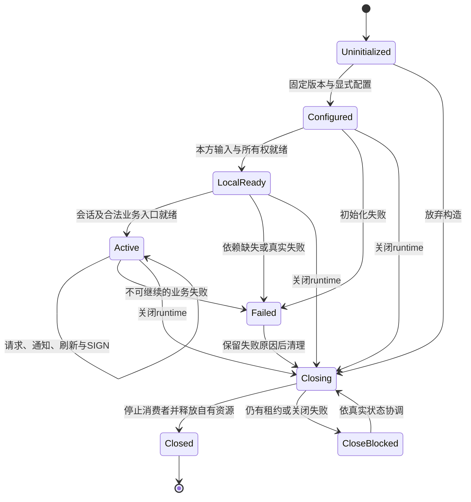
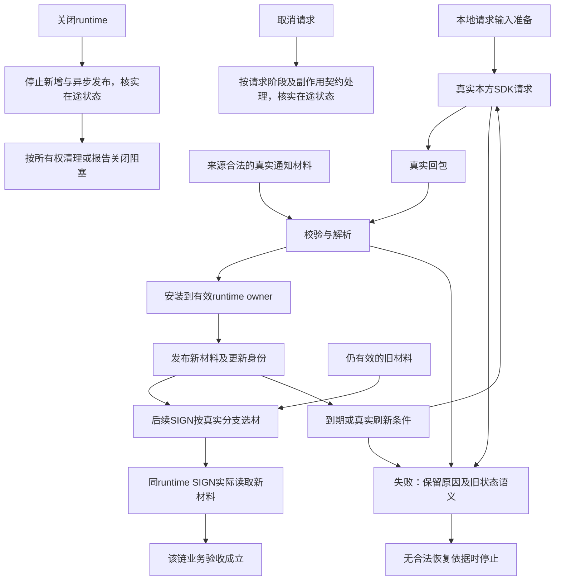

# 签名业务状态机、当前进度与验收

唯一权威标识：`SIGNATURE-STATE`；更新日期：2026-11-26。

本文件是签名业务状态、进度和验收的唯一现行入口。完整 Goal **未完成**。
旧 HANDOFF、报告、输入快照及 Git 历史只作历史证据，不是现行状态入口。
COORDINATION 只记录调度和操作，不另立业务状态机。
原长篇过程记录已由 Git 历史及既有 before/input-versions 快照保留，不再复制归档。

## 当前结论（实际探针分别绑定版本，2026-11-26）

实际 Qimei 启动运行绑定源码 `e846a5b9afaf84886262f7bc8e7ac8b2da7e0480`；后续自有存储Native I/O探针绑定 `6ecfc5338ebd46e1edd4b4bc4b6ca9c364ae7676`。Own硬件GUID实际探针另绑定 `831027cf87963a6fd2c0abe41f0053354146298d`，有限新设备身份生成／持久恢复通过，不改写前两个实际运行版本。该版本承接 `2cee40dc888f26bca62c537de7ca28edd3fca3b5` 的 selected12 reply 可选 extension 修复。原 Own type1 实际收到184B，当时止于旧 parser；修复后对同一保存 frame 的离线解包得到关联 command/wire、SSO -10003 与空 payload，不追记为当时已完成 public completion。该 SSO 负状态与历史143B的 SDK1003分属不同层，均无已证根因。

PUBLIC LLOneBot8.3.2 支持 `send_pb`，但唯一一次实际 NativeEnvelope SDK-body 控制失败：OneBot status=failed／retcode1200，携带 PMHQ code=-2／`build scratch failed`，data=null；outer echo 匹配，回复 command 关联未建立，无 SDK reply。1200不是 SDK retcode；也不能据此断言 SDK 请求未上网或服务器未检查 body。该控制绕过 Own SSO/header/initial SIGN，Native 是否改写／再签未知，可能依赖 Original SIGN，不能作为 fullOwn 证明。

本次 genuine137、Source f7 call/return 各1，CAPI acquire/generate/release 各2，CREATE1、运输初始 Own SIGN0、completion0、next SIGN0，真实认证／安装／发布／消费均未达，install/consume仍0。Local pending cancel1→0；socket、owner、core及4个借用采集资源 close 返回，child已reap，session87493已退出。仅本地资源静止，remote Native pending UNKNOWN。

安全结果及错误补充见 `A/overall-signing-service/native-sdk-body-control/OUTCOME.md`、`OUTCOME.json`。既定一次 exact error boundary 只读核对已完成，见 `A/overall-signing-service/PMHQ-SCRATCH-ERROR-BOUNDARY.md`：公开／已装JS与已知binary ASCII未找到确切literal／-2出处；llbot.js:72789–72794仅封装收到的res.code/message，未发现可实施的caller contract修复，实际Native失败步骤仍opaque，不能证明未发送。Root已搁置此诊断信道，等待上游支持契约或可用替代地址；用户地址问题仍待答，不要求内部keys。无SDK重试或新GO。取舍背景见 `A/overall-signing-service/POST-NATIVE-FAILURE-OPUS.md`。完整 Goal ACTIVE；SDK／Token／Qimei、合法通知及 protocolTokenHex 异步消费者仍待完整验收，禁止将 SIGN.token 别名为 protocolTokenHex。

## Qimei startup 组合增量（Source／MODEL）

`primary_qimei_application_binding.start_application` 现消费原 ApplicationBinding 与调用方共享 StartupState、context／selector／raw-cipher observations，cold mode1显式folder API先0x23、仅失败再0x1A，成功路径追加Tencent/qimei并检查／创建目录。复用原StartupState、codec及identity parser，main.profile_records实际进入assemble_provider_profile；返回bool仅指identity未变，普通缺失／坏文件可正常置once，异常保留前缀且不强制once。callback引用由调用方跨appid共享、非NULL首次获胜，arg7仅NULL gate；无callback调用／Native注册证明。

该组合实现的原证据为Source／MODEL输入链；后续实际identity1读取见下节，不将其外推为非空record1恢复、Qimei发行或完整a2。getter.initialize/restore及cold bootstrap保持原Boundary；697FA及后续有限cold job组合见下节；完整任务调度、AUX690A5、ready与模块生命周期仍未闭合。SDK认证安装发布／同runtime新材料消费仍0，Full Goal ACTIVE。实现证据：`A/overall-signing-service/qimei-startup-composition-implementation/`。

## Qimei 实际启动：identity changed，main 按 Source 跳过

`OP-QIMEI-OWN-STARTUP-01` 在上述 e846 源码完成一次实际 Own 配置启动。输入域明确为 OWN_KNOWN_ZERO_BEFORE_API：11264B在GetAdaptersInfo前由本方实际初始化为零，已知性来源与API写覆盖分开，不冒充OriginalQQ未知preimage。GetAdaptersInfo调用1次，primary adapter分支产出非零6B selected6，fresh producer经实际classifier/storage流程得到空context；NetBIOS调用0，未到RESET或compiled fallback。

合法所选identity1文件读取144B，经原raw codec与identity projection产生3次更新；随后Source比较判identity changed并清空3个identity记录，跳过main读取，正常置once1。identity0未读，identity0与main文件存在性均UNKNOWN。record1未恢复；profile_associated=true仅表示None==None，不是非空profile、材料认证或消费。所选adapter AddressLength未记录，原比较identity在clear前未保存，不能把不匹配归因于Own preimage或某个adapter。

backend/context/core显式close返回，child RC0并已reap；folder WinDLL引用由child退出释放，没有explicit close。本地静止，无cache内容写入、SDK／网络调用或本探针Native pending。实际1次special-folder createTRUE及1次directory check，无CreateDirectory调用；special-folder原先是否存在／是否由该调用创建UNKNOWN，Source持久目录效果按授权保留，实际路径仅在T。未生成Qimei发行材料，fulla2／getter initialize/restore／AUX／ready仍未闭合，真实install/publication/next SIGN新材料消费仍0，Full Goal ACTIVE。

证据与身份补充：`A/overall-signing-service/qimei-actual-startup-probe/OUTCOME.md`、`OUTCOME.json`。最新取舍见 `A/overall-signing-service/QIMEI-POSTSTARTUP-PRIORITY-OPUS.md`：后续Source研究已闭合有限cold material job接口并实现下节组合；真实材料仍要求合法当前请求的匹配服务回复，不是新actual GO，不读取被跳过main、不换key／MAC或绕过identity changed。既有14项Source／MODEL测试按原输入范围复用，不将其重标为此次实际材料验收。

## 有限 Own cold material job 与 Windows carrier（Source／MODEL）

原 `QimeiRequestPipeline.run_cold_material_job` 现组合单次同步任务：要求原ApplicationBinding、同settings/context、shared startup.once1且main逻辑空、原pipeline/dispatch组件与未完成reply，错绑或warm状态在IO前拒绝。实际beacon globals.refresh_config先行；50D00语义直接调用同settings.refresh，再读record[1:9]，随后调用Source日历秒时钟；unsigned64 elapsed>=86400先判断，未达才读mainempty。原producer.populate/ANSI encode生成body，固定Source logical kind1（不是attempt budget3），仅一次既有dispatch保留原sequence/key/context；原reply.receive的accepted非空结果才commit_server_reply，main persist后identity依次persist，异常保留已发生前缀及原pending。persist由调用方显式绑定授权存储，无默认写QQ系统cache；借用资源由调用方负责，不隐式取消或重试。

新增WindowsQimeiCarrier提供独立permit约定下的同步clean-EOF WinINet载体，own域curl_table=None。每请求沿用Source flags 0x80E03000（包含忽略证书CN/date的Source标志，仅此请求句柄，不修改全局设置），固定请求字段与原body长度。调用方须在最后一次perform返回或抛出后、在创建线程显式关闭借用NativeWinInetPort；close通过_ctypes.FreeLibrary释放自有模块引用，幂等关闭；释放失败保留所有权，未清HINTERNET债务阻止卸载，关闭后拒绝调用。不能以Python引用回收冒充卸载。send_attempted与send_return_success分别记录尝试和返回值，HttpSendRequest false或抛出均保守保留remote-send uncertainty，不能据false断言未发送；原异常cause和partial bytes保留。没有查询HTTP status，不把API/source_status与HTTP状态等同；read失败即使已有partial bytes也抛出并保留失败/关闭证据，不作为正常completion。未实现Source curl fallback、certificate diagnostic bookkeeping、CreateThread/软等待/线程状态映射；同步API可能阻塞，不声称完整Source传输或scheduler生命周期。

容器关联修正：material.sdk必须是原producer.sdk_contexts，且get(owner)返回原binding.context。旧guard误把material.sdk要求为单个context，与实际material.produce内部get(owner)矛盾；旧MODEL将material.produce替换为受控port，未覆盖此实际工厂接口。现新增完整生产类型工厂MODEL：原producer.populate、实际material.produce/header serialize、envelope/transport编码、原dispatch保留请求key/context、原reply/commit均执行；仅OS API结果、熵/时钟和carrier服务回复为显式MODEL，非真实GUID或服务材料证明。保留原owner/settings/signaturegate/dispatch identity检查，错容器在IO前拒绝。

验证仅为Source／MODEL：当前7项job测试通过（原5项组合及2项真实工厂接口MODEL）；既有dispatch4项与carrier14项在未变输入范围复用，共25项有效检查。旧9项组合/dispatch记录保留原范围，不补写为实际material接口已证。manifest guarded loader只导入新入口与carrier类并关闭core，不实例化载体或加载Windows库。既有e846的144B identity changed／main skip实际证据保持原范围，无新增OS／HTTP／用户文件／SDK／Native调用；真实Qimei材料、SDK安装发布及同runtime新材料SIGN消费仍0，Full Goal ACTIVE。fulla2 scheduler／callback mutex／retry budget3／getter-ready／AUX与独立Own SDK缺口仍未闭合。证据：`A/overall-signing-service/qimei-cold-job-implementation/`、`qimei-wininet-carrier-implementation/`。

## Store 序列化与显式 Own 存储（Source／MODEL＋自有临时文件IO）

`serialize_store_payload`／`persist_store` 现接通Source4044C有限写格式与既有MainWriter。mode0按原vector顺序复制，按signed capacity截断／补零，保留重复记录及内部NUL，canonical main输出53B；已知空b-empty不是未知None，首次main0生成后空record1仍可合法写53B。mode1先读并解码整个旧plaintext对象再取原store锁，在锁内合并／序列化／写入；支持旧及当前canonical keys0/1/2的String对象，后重复覆盖，保留未覆盖键，无capacity截断。严格Source字节转义（含slash、控制符大写hex及nonASCII原字节），不借通用JSON默认编码、不加header／magic。未知、NUL、不支持tree／key／escape或失败／不完整decode均Boundary，不当作缺文件。总capacity0无写入返回None；实际写入返回原writer int，commit调用方必须区分None／0／非零，不得伪成功。

OwnQimeiMainWriterObservations与typed factory复用原MainWriter／codec／context：逻辑Source path精确映射到调用方专用Own root下固定物理文件，仅改物理归属，不改明文／加密语义。main与identity可用分别显式绑定的Own writer/root；原commit仍main后identity，失败保留实际前缀，无事务回滚。Own beacon也有typed factory，生产profile读取为惰性Windows原API，文件名在调用ANSI API前使用严格mbcs编码并要求无NUL及无损roundtrip；不能表示／best-fit／缺codec均报错，不冒充缺失或默认值，测试profile明确scripted。既有Own ACL路径仍限ASCII，不声称一般Unicode ACL支持。无QQ数据扫描、原共享cache写入或父目录ACL授权；调用方须保持专用root独占，检查symlink/junction/hardlink的有限域不覆盖恶意并发路径替换。

新验证为serializer9项与storage12个唯一case（各自输入指纹绑定；profile编码修复后仅重跑2项、10项deselected，其他有效证据复用，并非21项全新执行），含Source identity_3fafa接受MODEL CoCreateGuid后首次main53B经真实MainWriter／codec写Own临时文件、旧cipher decode／identity合并、ordered commit部分失败；不是actualDeviceGUID来源证明。完整ACL成功链MODEL通过真实factory和NativeOwnedAclPort逐API typed buffers执行，Source IsAdmin TRUE，NetApiBufferFree＋4 HeapFree及解密53B核对通过；仅替换底层API函数，无实际Native ACL/profile调用。旧DACL的ACE复制／control-mask分支仍待验。调用方在所属epoch/thread显式close_native，heap/net/FILE债务阻止卸载，模块FreeLibrary失败保留所有权；原MainWriter忽略fclose状态，返回0不等于无句柄债务，须核对audit/cleanup。

证据：`A/overall-signing-service/qimei-store-serialization-implementation/`、`qimei-owned-storage-implementation/`。manifest guarded loader仅导入serializer／persist／Own factories并关闭core，无Native后端实例化。既有pipeline/carrier25项证据按未变范围复用；e846实际144B identity changed/main skip历史不变，本增量没有新actual probe。仅测试专有临时文件IO；没有原用户cache、硬件、Native ACL、HTTP或SDK实际调用。该存储增量本身不证明actual GUID；后续Own硬件GUID实际结果见下节。完整生命周期、getter／fulla2、真实发行／安装／发布／新材料SIGN消费仍未达，Full Goal ACTIVE。

## Own fresh hardware GUID 与已完成自有I/O资格

新增公开 `OwnFreshHardwareIdentity(profile_path,machine_info_path,hardware)` 与 `WindowsFreshIdentityHardware(cpu_source,api=None)` 两步组合，不新增假工厂或改旧consumer。Windows后端使用既有WindowsDeviceHardwareAPIBackend.request，CPU输入兼容既有WindowsDeviceCollectionObservations.cpuid。cold disk0沿固定Source磁盘请求，ordinary open/query失败取SPACE；成功descriptor使用实际写覆盖、offset/CString边界及固定C表ASCII0x107 alnum判断，非ASCII边界不冒充Unicode分类。CPU三叶48B寄存器字节保持Source顺序／NUL语义、不trim空白；adapter111→0查询保留OS首adapter/IP顺序、不排序，实际写覆盖中地址扩展为raw8再hex，Source三段MD5进入原QimeiApplication。

这是显式Own新设备profile策略，不是Legacy／Registry20／Native GUID恢复。构造不做IO；有效Own profile先复用，不再采样硬件；首次仅允许已确认缺失的machine-info，existing/unknown或malformed profile均Boundary。profile带版本／Source policy及路径绑定，exclusive创建并fsync后才返回；首次硬件／持久化失败锁存，保留已写前缀，无覆盖／重采样。调用方负责资源关闭与独占设备归属。9项Own临时文件／scripted硬件测试按准确文件指纹复用；Source/测试已独立审查并完成manifest及导入绑定。后续 `OP-QIMEI-OWN-FRESH-GUID-01` 在831027完成一次真实Own硬件采集：磁盘IOCTL成功、GetAdaptersInfo实际111→0、CPUID固定三叶，Source顺序MD5得到raw16并进入原QimeiApplication的GUID hex32（业务map43B）。磁盘具体SPACE谓词分支未记录，不能声称磁盘字符串非空格。配置的Own machine-info实际缺失，Own profile经exclusive写入及fsync返回后才返回application（按固定源码执行路径，不是独立syscall计数）；同actor缓存和新actor恢复保持同GUID，第二次硬件采样0且backend未创建。磁盘CloseHandle与模块FreeLibrary各成功1次，actor/hardware/backend及借用CPU关闭，child RC0并已reap；没有详细资源余额数字。该NEW策略不证明Legacy导入失败、Registry20恢复、当前QQ Native GUID相等或Qimei发行材料；main0运输UUID、application硬件GUID及QimeiMainMaterial互不等同。未调用HTTP／SDK／SIGN，新材料install/publication/SIGN消费仍0，Full Goal ACTIVE。后续Own settings initializer路径适配仍为架构设计，不据此声称真实HTTP已就绪。证据：`A/overall-signing-service/qimei-fresh-guid-implementation/`、`qimei-fresh-guid-integration/`、`qimei-fresh-guid-actual-probe/OUTCOME.md`及`OUTCOME.json`。

另外，`OP-QIMEI-OWN-STORAGE-NATIVE-01` 在上述6ec源码实际完成有限Own I/O资格：原identity_3fafa调用真实CoCreateGuid得到16B transport main0，record1仍已知空，原formatter／MainWriter写53B plaintext对应64B ciphertext，实际Own文件读取解密逐bytes匹配。辅助beacon raw16／hex32与新actor native profile读回一致；仅证重读结果一致，未观察cache accepted还是重新生成，不是Qimei issuer或非空record1。自然ordinal680后ACL未进入，gate BOOL未单独记录（按fresh状态及无子API／last_acl_code推断skip），ACE/control未知。6个资源及core关闭返回、child RC0已reap、所记录file/allocation债务0；不扩大为所有WinDLL GC卸载证明。仅专用Own文件，原cache/服务未动；SourceHTTP／SDK／SIGN调用0。安全证据：`A/overall-signing-service/qimei-owned-storage-actual-probe/OUTCOME.md`、`OUTCOME.json`。e846实际identity144B changed/main skip历史原样保留；完整getter／fulla2、真实发行／安装／发布／新材料SIGN消费仍未闭合，Full Goal ACTIVE。

## 显式 Own settings 初始化（Source／MODEL＋自有文件IO）

`QimeiSettings.initialize_owned_path(*,path,...)` 与原 `initialize(owner,observations,...)` 共用最小初始化helper：原constructor的03＋zero record、固定default_flag_arrays及有符号count／backing边界不变，按path→first copy→second copy→initialized最后发布的顺序执行；重复初始化返回False，不改loaded/dirty，异常保留已完成前缀。原入口仍使用原Shell路径流程，Own入口只是明确替换位置策略，不伪造SHGetSpecialFolderPathA结果或冒称Source folder lifecycle已执行。

`create_owned_qimei_settings` 返回原 `(settings, settings_dependencies)`，调用方显式配置专用Own root，限定settings子目录及Source owner-MD5 basename；runtime／epoch／线程／permit和目录身份在IO前核对。原Source settings路径仅用于文件归属，不参与record/context加密；Own依赖只读该精确物理文件，真实缺失返回b-empty并保留Source默认record／flags，权限／读长变化／坏cipher不转为缺失默认。目录失败不发布已初始化settings，仍由原refresh→record[1:9]→Source calendar clock进入cold job，不手工置ready、loaded/dirty或强制flag16。借用codec/context/observations由调用方负责，没有额外manager／bundle或原QQ目录写入／ACL效果。

10项检查（7新Own settings＋3原Windows settings回归）按未变输入复用：真实Own临时文件cipher refresh／timestamp／flags、原producer/material/header/envelope/dispatch/reply的完整工厂MODEL接线通过；底层API／熵／service回复为显式MODEL，不是Native I/O重跑或当前服务器settings证明。既有实际硬件GUID的831运行及Own I/O的6ec运行保持原范围，不重标到本次集成版本。没有新actual API／collector／HTTP／SDK／SIGN调用；真实Qimei服务材料、安装发布及新材料SIGN消费仍未证明，Full Goal ACTIVE。证据：`A/overall-signing-service/qimei-owned-settings-implementation/`。

## Fresh-default settings 依赖图与完整纵向 MODEL

当前有限cold job统一同一个原Own settings dependencies字典：producer的timestamp／flags／extras与material共用，material逐次传入globals.model再传flag9；globals不保存appid专属依赖。cold入口保留原owner/settings/context/signature/dispatch约束，并在IO前拒绝不同deps对象。真实缺失Own settings文件仍返回Source2、loaded保持0，后续getter按原语义重复读同一端口；不能预载配置、置loaded1或关默认flags掩盖错误，后续真实IO失败直接传播。QimeiRequestSources.firmware_strings只转发原inner六字段getter；原请求extension_93ade仍为前五字段投影，material取第六字段，无新算法或空值兜底。

此前默认链失败及第四错重排见 `A/overall-signing-service/qimei-default-firmware-facade-implementation/` 和 `qimei-cold-settings-dependency-implementation/`，旧失败按其版本保留。当前12项受影响检查通过：5项fresh-default完整链／边界＋7项既有job。settings由Own工厂真实初始化默认数组（flag9=1、无预载MODEL settings），fresh context通过原classifier／NT storage处理明确的底层MODEL结果初始化；原producer、header/material、envelope、transport crypto、dispatch保留sequence/key/IV、原reply/commit均执行。SMBIOS原parser六个可区分字符串分别进入material第六项及请求前五；Source首次main0接受MODEL CoCreateGuid后53B经原MainWriter写真实Own临时文件，非空MODEL回复在原shared store上按main→identity→identity持久化并进入原profile assembler。bad reply不commit；部分persist失败保留前缀及pending；错deps在IO前拒绝；合法missing后重复读遇PermissionError不变成默认成功。

这里的OS API结果、熵／时钟／服务回复均明确MODEL，部分硬件分支为合法ordinary失败结果；不是完整Windows分支验证或实际服务材料。没有替换高层produce／model／populate，没有新HTTP／SDK／Native／硬件调用。6ec实际Own I/O与831实际Own GUID证据不重标；fulla2/getter/真实HTTP材料认证、安装发布及新材料SIGN消费仍未证，Full Goal ACTIVE。manifest/core导入检查不实例化实际载体，文档／manifest集成不触发重复行为检查。

## Own completion 的可观察结果

`complete_own_device_request` 返回 frozen `OwnCompletionResult(outcome, stage, code, cache_updated, publication)`；outcome为failed／processed。stage仅覆盖现有transport、sdk_envelope、sdk_status、auth、material、token_parse、publication路径，code按stage区分namespace，无源数值时为None。非法envelope不再把mode冒充状态码。1003经原状态树规范化后返回failed/sdk_status/1003，保留current及其他pending；不新增retry／refresh／callback／owner关闭策略。

processed仅表示publication wrapper返回，原dict详情完整保留，不代表setter／expire或后续消费成功。真实异常仍抛出并保留部分副作用。旧Pure Own reply MODEL close FAIL不变；没有decoder／receiver接线或新actual执行。证据：`A/overall-signing-service/failure-observability-implementation/`。

## 有限 source cold12 reply 纯解包

`decode_source_cold12_reply(frame)` 接受包含4B总长的单个完整immutable bytes frame，返回frozen `Cold12Reply`：version、encryption、flag、routing、uint32 wire_sequence、int32 status、三个header Strings（command是第二个）、compression、immutable有限extension字段、header_word及payload。总长精确相等是本方wholeframe边界，不声称原decoder本身做了该比较。

已实现received12、type0明文／type2 zero-key TEA＋7zero、BE/L32、GrayUinPro.Check条件skip4、compression0、空extension及源正向证明的top9/21/22/25/27、child1/2小varint＋child3 present-empty结构。值不是私有hash／固定值匹配。其他version／type1／mode、compression、extension重复／类型／group／overflow或多字节值域明确unsupported；畸形支持域抛InputError，未实现源分支抛PrimarySemanticUnavailable。header最后DWORD读取失败的源输出未闭合，也保留精确Boundary。

B已通过独立source review及6项MODEL检查；正式纯decoder现已对保存的真实143B完成CPU-only offline验证，16项逐值比较（header／wire／完整command／20B extension／3B payload等）全部匹配，SSO status0／SDK1003。此证明仅是正式纯解包器处理旧实际bytes，无owner admission／认证／安装／Native／新网络，C receiver编排现已实现MODEL检查，本轮真实owner已到sdk_status1003，响应认证／安装未达[RF]；旧1003根因unknown与Pure Own reply MODEL close FAIL均不变。证据：`A/overall-signing-service/source-cold12-reply-implementation/`、`A/overall-signing-service/source-cold12-reply-offline-actual/RESULT.json`。

## Own cold12 接收编排

`WindowsSigner.receive_own_cold12(encoded, frame)` 现复用原pending identity、encoded wire32／SDK64与原完整command，调用正式puredecoder后精确关联。closed／cross-owner／late／cancelled、畸形／unsupported／不匹配均在stateful fatal scope外拒绝，不消费pending、不污染健康；无新增encoded集合或receiptregistry。SSO0仅调用一次现有public complete并原样返回OwnCompletionResult；非零signed SSO仅public cancel目标，返回failed/sso/真实code，保留其他pending。取消只本地终结；无callback／retry／reSIGN／send／drain策略。

binding active finally始终清理，不嵌套既有public operation；真实complete／cancel异常按原fence抛出，部分副作用不回滚、不转成功DTO。MODEL使用实际Bparser及原pending检查、明确公共操作ports doubles；尚未在真实owner执行该receiver。A15MODEL、B6MODEL／16项保存实际wire offline验证分别复用其原范围，不等于真实认证／安装／发布／后续消费。旧Pure Own reply MODEL close FAIL及SDK1003根因unknown保留。证据：`A/overall-signing-service/own-cold12-receive-implementation/`。

## record137 空value的source ABI

feature46 ON 的默认路径 `encode_record_request→encrypt_device_records→RecordCipherHost→PrimaryVM` 已核对。fixed source BD69BB..BD69CB 对空value写NULL／len0；adapter现按此投影，不再为空bytes分配非NULL backing。非空值仍按显式len复制并追加NUL，embeddedNUL与原清理所有权不变。该NULL修复已获独立review APPROVE及4项检查PASS。原1105B固定MODEL fixture含key0＋empty，修改前后逐bytes相同，不向actual外推；另以actual137 records＋明确MODEL host参数做baseline／candidate独立CPU各一次，两者均4491B且逐bytes相同。这是HYBRID／MODEL敏感性对照，不是原actual cipher复现或独立cipher真值。

既存actual安全报告确认firstsnapshot137有2条empty、无key0＋empty，savedtuple与plainrecords一致；原值仅在可信本地分析中使用。zero-keyempty PB差异不在本次修复范围，未改。旧唯一网络交易的actual cipher调用state17／PID／wall_seconds／formatter_options未进入snapshot，因此该旧交易的actual137-counterfactual仍UNKNOWN，不能用新离线交易回填；虽有records及cipher输出，也不等于保存全部原始inputs。未拿监督PID、currenttime或默认值补齐。VM是否在其他输入观察NULL差别、实际cipher／1003因果仍未证。证据：`A/overall-signing-service/request-independent-points/record137-empty-abi-implementation/{RESULT.md,sensitivity.json}`。

## 请求生产独立检查的当前边界

P256原受控检查0/24在首个scalar1 raw-scalar oracle差异停止，原FAIL保留。后续known peer private7的6/6 server-side ECDH／HKDF一致；非均匀／highbit的4个正常域case也匹配raw-scalar oracle。旧网络交易保存的client public精确对应sentbody field2，client／decodedpeer两点均合法；这不证明该旧交易ECDH key正确。source co-Z scalar1 bitcount映射仍未闭合，finding归档、不改算法，不声称QQ故意非标准或已排除所有ECDH问题。Opus先前系统性猜测已撤回，顾问意见不作source证明 [RI]。

fresh command selector值匹配已证，不等于执行原callback或传输资格。137／profile确实进入AEAD/body及SIGN，不是未使用输入；但其完整独立正确性及1003因果仍unknown。原采集方案经修正、审查后已整合进一次新的完全离线actual：完整137／真正四cipher参数、实际CAPI private／blinding、原helper返回sharedX及request／SIGN／frame已完整采集，并完成下述密码与数据绑定核对 [OFF]。旧唯一网络交易的四参／private仍缺且不可回填；以后实际运行仍须保留版本绑定的producer全参及必要CAPI输入，不能只存成品DTO。该新离线运行不授予新的网络probe GO。既有VM trace feasibility已确认局部观察接口，尚未执行算法trace；静态mix bridge／条件mask用法仅是IR/lower假设，native handler展开暂停，不授权重建VM或扩算法研究 [RI][CUR]。

## 新离线生产请求的完整采集与独立核对

一次NEW actual Windows／SystemRequestCapi生产Own初始化→one CREATE→正常SIGN／sourcecold12封帧已完成，同一有效owner，全程无QQ socket／DNS／connect／send／recv、Original DLL或重试。这是新的离线样本，不是旧143B网络交易。12个完整事件包含真正137及state17／PID／wall_seconds／formatter四参、private／blinding真实CAPI前后knownness、原helper sharedX、全部DTO／pending identity／SIGN／frame。独立cryptography实输入28／28比较PASS：pub／固定peer／sharedX／HKDF、body ASCII field4、GCM、cipher／ordered records／plain及frame等 [OFF]。

环境Python3.14.3 optimize0、cryptography46.0.7；14项analysis／11项source及profile／helpers在运行前后未变。public cancel／close正常return，child实际exit0、parent0，匹配owned进程alive0；没有逐native handle全关闭证明，旧Pure PrimarySigner MODEL close FAIL仍保留。一次准备目录pyc自动写入已按精确路径清理，不能称完全没有意外写入；C源码未改。该样本只证明本方新离线请求的密码学／输入绑定比较，不证明server key、完整SIGN数学、137内容真实性、1003原因或正材料闭环；真实网络正材料仍0、同owner下一SIGN消费新材料未证 [OFF]。

## 本交易AEAD与1003后的请求状态

本笔唯一SDK1003交易现已独立cryptography AESGCM完成41项检查PASS：key32／nonce12／tag16／AAD0，body field5逐bytes等于saved sealed，认证解密逐bytes等于saved plain。该笔证据独立于历史a7 PASS，只证明保存key／plain的本交易对称封装自洽，不证明server key agreement、SIGN、137正确性、1003原因或材料闭环；旧历史报告缺per-input digest等限制不被补写消除 [CUR]。

1003保留的168B current是本地请求crypto状态，不是已安装server材料；1003不设置60s TTL。有效同owner／未过期下一CREATE会复用该状态（regenerated=False但仍mode0），重新序列化并消耗原random流生成nonce，仍可选择Establish，不是新server-confirmed材料或rawbody自动重发。wall-only expiry的native路径是telemetry1BEFC10后AL0复用，不是新throw；Own已有缺clock依赖的Boundary保持，不能把三参runtime helper直接塞给Own一参接口或用noop替代。完整source结论来自leaf；Opus已撤回错误clock patch建议，clock遥测扩张停止 [CUR]。

state17 mix只有静态bridge及有条件的后来byte-mask使用证据，不是native公式、key／IV或finalcipher证明；handler展开暂停。原actual-input-capture-completeness仅是A候选／MODEL证据；后续offline-request-crypto-a1已另行完成一次新离线生产采集及验证，不能反写成旧网络payload当时已接入、旧四参／private已恢复 [OFF]。固定源已确认原称provider+28是可空generic persistence type-erased callable：callsite1BE5A53，activeptr677BE78／inlinebase677BE60，fixed init1BE5CA7置NULL，NULL直接跳过；非空CALL[vt+28](receiver,keyString,&encryptedString)返回值未用，destructor区分inline／heap slots。C worker／caller queue共享持久化，caller仅在未映射时映射fresh NULL，不强制清空已有对象；非空installer／实际vtable仍unknown，不能称永远external或全局不存在。optional持久化不等于in-memory安装发布，也不是所有fresh成功的必要发布Boundary。合法fresh NULL路径目前未建立无条件必经的未实现postinstall函数；真实成功reply字段仍可能先触发settings通知Boundary [PERSIST]。本轮无新网络，业务真实正材料仍0，完整Goal未完成 [CUR]。

## 历史真实fresh诊断：关联completion通过，SDK仍拒绝

本轮ONE真实Own fresh请求保存137条真实records、真正cipher四参、实际CAPI private／blinding／sharedX及全部request／SIGN／frame，发送8850B，收到143B；同一个有效owner的原pending经正式receive_own_cold12完成wire／command关联并进入public complete，正常返回failed/sdk_status/1003、cache_updated=False、publication=None。诊断前缀PASS，真实SDK业务／材料Goal FAIL；这不是异常或正材料 [RF]。

离线读取该真实回复：SDK body精确3B，仅field2／wire0整数1003，无server描述或子码；SSO两个说明String为空。拒绝发生在SDK envelope非零状态分支、响应AEAD／验签／token解析／安装发布之前。SDK cache前后空且未变，清理前bound空／expiry0；非空Own current等于本请求decode_material.raw，是请求crypto状态，不是新SDK安装。没有preinit baseline，不补造其演化。后续SIGN前置不满足，选材／digest观察0，消费未执行，真实安装及sameowner下一SIGN消费仍0 [RF]。

与旧143B只rawcapture、owner关闭后纯decode不同，本轮已真实关联publiccompletion且完整输入可诊断；本轮实际已发送样本另行独立核对28／28 PASS，覆盖P256／ECDH／HKDF／GCM及request／plainrecords绑定；未重用旧offline28冒充本轮结果。另对实际8850B outbound frame有限解封，提取8379B SDK body与原request.body逐bytes相等，wire32／完整command亦匹配。这不验证inner record cipher／完整SIGN数学、server agreement或1003原因 [SENT]。既有OwnFreshCold12Binding链一直存在，不是整体缺adapter或必须等待login入口。旧Sourcefreshframe经51728-origin rawconnector不等于51728完整packetprofile；旧9freshconfig无producer摘要已由fresh-options／listener证据在fresh范围取代。Source U／predicates／send delegate仍UNKNOWN，不升格为server-auth/login门禁或唯一外部阻塞；endpoint资格unknown不等于不可用或已证不兼容。1003也不证明SIGN／cipher／metadata正确或endpoint错误，不自动重试／换参数／发下一网络请求 [RF]。

parent／child均0、原Popen已reap、匹配owned live0，failures=[]只说明诊断及所走cleanup未记录错误；actual cancel次数／pending清除／owner.close返回flag未独立capture，不能补称全部handle关闭，冷0a2的有限close证据保持原域。其余SDK／Token／Qimei／合法通知／protocolTokenHex异步空值／UIN配置／refresh／失败取消关闭所有权及innercipher／SIGN独立真值仍须按完整Goal验收 [RF]。

## 官方 SDK 正状态与 A2 当前边界

固定官方 QQ9.9.33-52230／PMHQ9.0.6 的SDK-only28条记录构成14组exact command＋sequence配对，回复全部为SDK field2显式0。A2Establish一组send275B／recv485B（cipher480B）；A2Access十三组中十一组为空cipher0，两组cipher48B／details32B且caller为getToken。这是官方真实SDK正外层状态和非空密文材料候选，不是已解密／认证／安装证明，更不是Own同runtime消费证据 [SDKH]。

当前Own已有A2／nonA2 body、四命令选择及共用response认证／安装入口；f6是本方生成的device_random32，f7是nonce16＋对SHA256(完整f5)的确定性transform32，并非已证登录凭据要求。官方完整f5／f7提供独立指纹参考点；一次纯生产request_fingerprint(SHA256(完整官方f5), 官方f7前16B)与独立官方f7比较已完成：完整48B及尾32B均不相等，首差异offset16；前16B相等是输入透传，不构成算法验证。该合格官方向量DISAGREEMENT不等于已证Source bug或1003原因。相关输入前后身份一致；首次harness命令selector断言在调用前失败，仅修正selector后执行一次纯函数，未试算法参数。独立静态Original Source核对已证当前内置mode1指纹资产取钥地址错误：冻结r37提取器读RVA41B1CA0，实际内置分支读RVA41B1CF0；当前资产及loader／manifest绑定已按后者修正。AES S-box、BE128当前counter先用后增、SHA256完整f5输入和nonce均未改。运行时provider／hook门状态及实际调用路径仍未知，不能据此证明官方捕获走内置分支或解释1003。修正后的官方同向量独立复核已完成：相同不可变tuple、一次纯函数调用，完整48B及尾32B仍均不相等，首差异offset16；独立expected与修正前失败记录未改。因此内置资产来源修正有效，但未解决官方指纹不一致，SDK install／Own consume仍为0 [A2][FP][FPKEY][FPRECHECK]。

官方A2外层需type1；fixed52230合法selector及transport peer／key／ticket producer实际绑定尚未ready。当前fresh cold12仅支持nonA2／type2，不得改命令、放宽白名单或将experimental51728 reference冒充fixed52230证明。官方A2与Own nonA2的场景差异不证明1003原因；登录另有owner，不把未知transport输入泛称登录必需材料。Own真实认证安装及同有效runtime下一SIGN消费仍0／未证，完整Goal保持ACTIVE [A2][RF]。

## 修正内置指纹key后的唯一实际回归

`OP-OWN-SDK-POSTKEY-01` 在候选cf012eb执行一次：实际137条records、发送8866B frame、收到143B reply，同一原pending经public completion返回failed／sdk_status／1003，cache0→0、cache_updated=False、publication=None。响应认证／安装及后续SIGN未达，选材／digest观察0，没有新材料消费；完整Goal仍ACTIVE。相同1003不证明outbound未改变，也不能排除修正与失败的因果关系；未重试，本次actual未另做独立密码数学复核 [POSTKEY]。

本轮实际pending1→0，cancel因无pending而未执行；owner.close、core.close及四个采集资源close均正常返回，failures=[]。parent／child退出0、child已reap、resources0只证明该诊断和所记录清理，不是业务成功或逐handle全量证明 [POSTKEY]。

当前`request_fingerprint`纯函数仅建模内置分支，修正的是该分支41B1CF0 key；合法VM路径使用独立41B1CA0，不能因修正key就称完整Source provider算法已完成。三个当前进程均观察到first predicate1BF81B0、second predicate1C00F90及provider1C00BC0已注册、latch0；但first predicate为false时不论latch都走VM/provider。后续被动读取在身份未变的三个进程中均遍历2个category节点，key0均MISS，故first predicate为FALSE、latch0；按Original控制流，若当前状态调用入口将选择VM/provider。config tree无需读取、state不适用。两个对象均非空，provider／second的实际vfunc分别为wrapper RVA2C5CAA0／2C5CB70；String内容与second返回bool仍unknown。93次／642B读取及关键readset复读稳定，但未持原mutex，非原子快照，不能证明历史SDK caller／分支或1003原因 [FPPROVIDER][FPSTATE]。

现有通用PrimaryVM可复用；796B／85 records及嵌套5428B／638 records已静态解码，具体缺口是class4 opcode body、host1D2AB3E及8192B table绑定、少量parent host adapters与当前动态table输入；静态解码不是执行通过，也未证明需要新建整个VM。按当前取舍暂停VM实现；备选A的被动读取已完成并关闭全部handles／helper，resources0。下一未知为上述两个实际vfunc的provider输入语义Source契约，仍在只读核对；无新增VM实现或SDK请求 [FPVM][FPSTATE]。

## 整体大签名服务

当前交付形态是 Python 库与 Windows 单 owner 的串行运行时；正常 core 已实现并实际产生 SIGN 三字段，不只是接口外壳。限定当前 C 的入口检索未发现 HTTP 服务；这不是新增 HTTP、部署或池化目标 [OS]。

| 层次 | 当前证据与边界 |
| --- | --- |
| ResultProduced | a7 与一次真实 binder 请求已产生正常 SIGN 三字段；后者逐 bytes 核对并实际进入 frame、发送。 |
| 独立数学 Verified | 完整 SIGN 尚无适用的同输入独立真值。reference/direct 共享 PrimaryRuntime、程序及 host 族，reference 也可进入 direct helper，不能自动充当独立 oracle；限定已知材料未找到可立即执行的完整独立点，不代表全历史不存在。旧网络交易P256因缺private scalar／sharedX仍不能同次重算；新离线actual样本的独立pub／固定peer／sharedX／HKDF已通过，不泛化全部ECDH或解释旧scalar1／1003。完整SIGN真值仍未证 [P256][RI][OFF]。 |
| 普通业务 Accepted | 已有两笔分开保存的 SsoEstablishShareKey 关联回复 SDK1003（旧rawcapture与本轮sameowner completion），不能证明服务器校验了全部 SIGN，更不证明普通业务命令已接受。 |

SDK1003 的源消息已知为“下游服务失败”，根因仍 unknown；它不是 owner fatal。上次 actual runtime 已正常返回级关闭，不是当前持续运行中的服务，逐 handle 退出仍 unknown [SA][BR1]。B 的真实新材料认证、安装、发布与同 runtime 后续 SIGN 消费未闭环；它可能影响首次及持续 SIGN，不能只称维护路径。源 counter→BA22B0→signed32 十进制临时量已证，但栈槽多生命周期／alias 传播未闭合，seq 的数学消费仍 unknown，既非已证 bug 也非1003根因；不新增 public seq 参数。

A失败DTO、B正式puredecoder及C接收编排均已交付：A15MODEL、B6MODEL及保存143B的16项逐值offline PASS、C／binder10MODEL分别限定其证明范围。C真实owner接收与public complete已执行，返回SDK1003；响应认证／安装／同runtime后续SIGN仍未达，B的旧actual saved-wire不能替代该新执行 [RF]。大SIGN独立真值与seq alias有界调查已停于上述unknown，不再并行扩大core恢复。下一方向先选择有具体可独立检查输入的请求生产边界／可证伪证据假设，再决定动作。Opus只依据完整简报给顾问意见，未作source audit；不把“所有合法reply已ready”或“本方已无事可做”当事实 [OS][POST]。完整Goal及下列未验收分支不变。

## 1. 目标、基线和职责

目标：固定 QQ 9.9.33-52230 源码及当前候选，完成材料 B 全链：
真实本方请求 → 真实关联回包，或来源合法通知材料 → 校验解析 → 安装 → 更新发布 → 选材 →
**同一有效 runtime 的后续 SIGN 实际消费新材料**。
SDK、Token、Qimei、通知回调、protocolTokenHex 异步消费者和空值语义、UIN、
配置、刷新、失败、取消、关闭及所有权均在签名验收范围内。

- 137之前的代码基线：`99611c569deb1688a248734ec7d3b31e7f9cb8c7`；本次137实现的输入与证据见 [W]。
- 完整137正常域候选已冻结；CORE 10 pure 与4项 legacy、WMI 5项与 Windows 5项检查按绑定证据复用 [W]。
- wrapper SHA256：`63112ab9161e127f5f7e17998a7196e143808923fb54cbbf7b4e21426187a5f0`。
- qimei SHA256：`a6100bce0de79ea52fe80a85acce2c24c615306fd3c2dedd119b51b0f26ebcc6`。
- 用户优先本方协议自行产出；不能以历史抓取值或伪造 receipt 替代生产链。
- Claude Opus 领导治理与方案取舍，已多次实际咨询；不是技术源码核验者或逐提交审批人。
- Root 负责工程协调、Git 和唯一调度记录；技术结论由职责执行者提供证据。
- 登录算法由另一负责人维护；签名侧核对会话交接与 SDK 消费，不接管登录算法。
- 既有实际 ONLINE 只属于 experimental51728/protocol12，不可重标为 52230 互操作。

## 2. 阅读证据的规则

`A` 是本地证据根：
`G:/Hackergame/.codex-workflow/reports/pmhq-analysis-20261010/signature-audit-20261119`。
下文 `A/…` 是安全报告定位，不是发布资产或运行时依赖。
不把原始密钥、UID/UIN、主机名、profile 内容或私人捕获路径写入本文件。

| 证据层 | 能说明什么 | 不能替代什么 |
| --- | --- | --- |
| 固定源码 | 语义、调用顺序、依赖与边界 | 当前代码实现、实际执行 |
| 当前代码 | 接线和可表达行为 | 执行成功、真实来源 |
| 受控模型 / pure | 明确输入下的分支和计算 | 真实 OS、COM、网络 |
| 真实本地执行 | 所绑定本方 OS 输入和持久化 | 服务器材料、网络接受 |
| 真实网络 | 所绑定请求、响应与会话 | 解析安装、后续消费 |
| 同 runtime 消费 | 有效 owner 内的更新到 SIGN 因果链 | 其他未覆盖业务分支 |

PASS 只适用于报告绑定的输入、分支和环境；源码变化后按影响判断能否复用。
旧内部 A2 等里程碑、组件 receipt、输出非空或长度改变均不等于完整 SIGN 完成。
下图与安全不变量是**逻辑目标契约**，未证明的边不得理解为已实现或已实测。

## 3. Runtime 生命周期（目标契约）

| 状态 | 进入条件 / 数据 | 退出条件 | 当前证据 |
| --- | --- | --- | --- |
| Uninitialized | 显式新 owner，尚无初始化成功资格 | 有效配置或关闭 | Qimei 局部 cold 合同成立 [Q] |
| Configured | 版本、UIN、配置及 owner 身份明确 | 完成本地依赖或真实失败 | 局部配置模型；整体待验收 |
| LocalReady | 完整本方请求输入与生命周期可用 | 合法会话和入口就绪 | a7本地137→codec→同owner SIGN及返回级close局部达成；算法未证 [L7] |
| Active | 当前会话可用且 runtime/epoch 有效 | 正常运行、失败或关闭 | 正常全 SIGN/SSO SDK 交易未证明 |
| Failed | 保留原错误、阶段和可恢复性 | 合法恢复或关闭 | key25 真实失败及恢复一例 [D] |
| Closing | 禁止新任务，处理已有消费者和租约 | 资源回收或明确 CloseBlocked | a7 owner及4资源close正常返回；逐handle未知 [L7] |
| Closed | 所有自有资源、任务均退出 | 终态；新工作需新 owner | a7返回级close及进程退出成立；完整B仍未证明 [L7] |
| CloseBlocked | 资源仍被使用或清理失败 | 核实后继续清理 | 不得伪报 CLOSED |

目标安全不变量：身份不得跨 runtime 拼接；关闭后不得发布材料或继续消费。
请求取消须按该请求阶段及副作用契约处理，区分已发送、已回包、已安装、未开始；
取消请求不要求关闭整个 runtime，不能把未知副作用改写为成功。
关闭失败须保留仍被租约依赖的资源；这些是待验收约束，非全局已验证结论。

## 4. 材料 B 与 SIGN 生命周期（目标契约）

| 材料状态 | 进入条件 | 退出条件 / 数据 | 当前证据 |
| --- | --- | --- | --- |
| InputPrepared | 真实本方输入完整 | 编码并经所需 SIGN 发请求 | 本次同owner binder/SIGN/frame一次sendall，command/body/SIGN3/sourcefresh字段逐bytes匹配；a7原无网络证据保持原作用域 [L7][BR1] |
| RequestPending | 适用的合法传输 context、完整载荷、真实发送 | 真实响应或明确失败 | 一次发送并收到首143B响应；SDK错误1003，不是正常材料交易成功 [BR1] |
| ReplyReceived / NotificationReceived | 真实请求关联响应或来源合法通知材料成立 | 直接校验、解析或拒绝 | raw reply的wireseq/cmd匹配；20B extension源接受未知，payload服务错误1003，无材料密文；通知路径未证明 [BR1] |
| Parsed | 格式和业务条件满足 | 安装到正确 owner | 单独 parser 不能算安装 |
| Installed | 新材料写入当前有效 owner | 发布并可供选材 | 尚无完整真实证据 |
| Published | 更新对实际消费者可见 | 后续 SIGN 真实选中 | queue/cache 写入不充分 |
| Consumed | 同一有效 runtime 后续 SIGN 读取新材料 | 记录因果证据，完成该链 | 尚未证明 |
| RefreshPending | 真实刷新条件、有效 owner | 更新成功或真实失败 | warm 行为与失败分支待全链验收 |
| Failed / Cancelled | 原因及在途副作用可诊断 | 仅按合法契约恢复 / 关闭 | 不用默认值伪装成功 |

SIGN 既是 SDK 交易的前置依赖，也是新材料的后续消费者；不能循环假定二者已成功。
本地设备值、17B、Qimei、SDK metadata/token、protocolTokenHex 是不同数据来源。
关系未证时不得等同，不能用其中一种填补另一种缺口。
刷新失败或空值是否保留旧材料须逐类遵循已核对契约，不能套一个全局兜底。

## 5. 当前已知进度与边界

### 本方本地输入

- `fc79bb8` 的 own cold 17B producer 使用真实 OS、12×4 RNG、6 次 steady 及实际容器地址。
  独立观测重算一致，资源归零 [M]；它是本地加密输入，不是服务器新材料。
  不得拼接不同 PID 捕获来声称 sameRuntime。
- `9af1040` 的 key25 本方 producer 实际使用 494 对象名、1 display 及已有 CAPI method6。
  完整 value/checkpoint 的独立数据流重算一致 [D]；原 QQProtect 与原文件未改。
- key25 a1 因错误 `_rand_s` 真实失败并留下 0B checkpoint；修为 canonical `rand_s` 后，
  a2 在同 root 恢复为有效 1028B，未删状态或另造 cold [D]。
  RESULT 的初始 offline not_run 字段不替代随后 DATAFLOW 的独立重算结果。
- CAPI method5 创建/null DACL 未授权、未 actual；profile fallback 未 actual。
  不得把权限拒绝吞为普通失败后强行走 fallback。

### 同owner共享设备值

- `owner.get_own_device_value() -> bytes` 经 WindowsSigner 原 `_operation`、PrimarySigner `public_call`
  调用 `caller_device_value(runtime)`，返回 owning bytes；它与正常 SIGN 使用同一 SLOT6751838 cached_value/1BE77F0。
  业务collector必须使用该getter返回值作为record25输入，不把provider d/token当设备值，也不注入factory缓存。
- actual a2 standalone producer 返回success并不证明其结果已发布到owner singleton；standalone own-state与owner client根不同，
  时间与rand_s header也可不同。当前结论是共享未绑定、可能不同，未观察到实际mismatch；既有独立producer算法证据仍有效。
  薄getter在a3已返回；a5返回137但SIGN未完成。Native819未覆盖输入仍保留Boundary，不绕guard。
- 存储仍沿用owner factory的显式DirectoryCheckpointStorage root；实际运行须绑定已有可信ownG root并保持
  `allow_capi_creation=False`。既有API允许显式opt-in，路径校验并非全局G盘限制；getter未增改该政策。
  既有WindowsCapiObservations在禁创建时拒绝0x68/GenKey及安全描述符/ACL/SetProvParam创建路径。

### Qimei 与 SDK 缓存

- `99611c` 的 QimeiGetterOwner 显式 UNINITIALIZED：ready0、module0、70B cache 零。
  get 合法 empty，不入 DLL、不 auto-init；不是原 QQ 正常 startup 或已初始化 a2 [Q]。
- fresh SDK config58 的源 constructor 独立零写；非空才 copy，empty 不清 warm 旧值。
  共享 SDK records27/28/89 已接入，3 pure PASS；不是完整 Qimei 或真实服务器接受 [Q]。
- initialized b 主段取 main record1、最多36B；aux32 的 690A5 未闭合。
  CONFIG refresh 两次，startup/cache 恢复另属 a2；这些未知仍是 Boundary [Q]。
- 全新 SDK metadata cache pair24 由真实源 ctor 清空；成功解析且 token 非空才更新。
  失败或 empty 不清 warm metadata；它不等同 Qimei、17B 或 protocolTokenHex [S]。

### 完整137与 Windows composition（正常域源码及受控集成已通过独立 review）

- CORE 最新执行者报告：受控 normal cold 8 WMI row/longString、
  真实 parser 选择非空 adapter、WLAN22 cold 默认1、ordered137 到既有 encoder 已贯穿。
  warm 仍 refresh；正常域源码及受控集成已通过独立 review，CORE 10 pure 与4项 legacy 检查成立 [W]。
  这些受控结果不是 genuine137 或真实 OS 采集证据。
- Windows composition 已接入既有 random_device/ANSI helpers，5项纯检查成立 [W]；
  actual a2 已进入初始cold snapshot，但止于 GetCursorPos 观察缺失，未取得真实137 snapshot。
- WMI 有5项 fake ABI 检查及独立 review：invalid BSTR 不得 clear，失败 clear 不得 retry。
  它们不证明真实 COM 已执行；阶段安全证据在 [W]。
- adapter ordinary failure 域未实现：ipconfig/all 备份 parser 与第三 backend 仍未知。
  primary 返回 AL 非零不触 fallback；真实 OS 触发未覆盖域时应 Boundary，不能强成功或空 adapter。
- identifier keys72..76 涉及 delete installStatus、3轮补读、FILETIME、randomdevice/MT、
  硬件 strings，以及 raw/digest/double 生成和配置/cache/installFlag 写入 flush。
  OWN_STORES 使用显式 G 配置/XML cache 与本方 HKCU namespace，不冒充原 QQProtect。
  actual a2 未完成137；原 HKCU Tencent QQProtect 删除或写入不在本方路径授权内。
  XML 声明/comment 等未支持输入保留 Boundary，不伪装为空。

### 本方 cold provider/bootstrap 入口

- `open_windows_signer(..., own_business_config={'uin': uint64_int, 'machine_id': persistent_bytes})`
  显式选择本方 cold profile；`host_profile_string` 必须为 `b'V1_WIN_NQ_9.9.33_52230_GW_B'`，
  必须使用 direct backend 与 owned worker bridge；与 outer login、diagnostic metadata 互斥；可选 construction hook 保留在业务初始化前执行。
- 从本方 UNINITIALIZED Qimei getter 取得合法 empty，固定源默认 QUA、规范 UIN ASCII、
  required 非空 NUL-free machine_id 构建既有 ProviderInitializationMetadata；不恢复原 QQ effective profile。
  machine_id 是本方持久 caller 配置，provider 与后续 SDK27/login handoff 须保持同值。
- 业务及 diagnostic 分别调用共有 provider-init/Host129 primitive，保留公共 owner operation fencing、
  pending bootstrap 检查及失败清理；不调用 diagnostic prepare 后重标状态。
  actual a2 的业务初始化已返回（控制流证据），不证明 SDKReady、材料安装或 actual SIGN。
  refresh/complete 仍用原公共入口；notify/update 公开映射仍未证明。

### 本方独立 cold SDK request component

- own-business owner 可经 `initialize_own_sdk_request(request_capi=..., clock_inputs=..., random_environment=..., state17_owner=..., transport_context=...)`
  一次绑定，再以 `create_own_device_request(records)` 经原公共 operation fencing 构造请求。
  clocks 显式包含 wall_seconds/monotonic_ns/clock_ns；生产环境借用 SystemRequestCapi、真实时钟及
  WindowsDeviceValueEnvironment.random_bytes(4) 的 canonical rand_s；不使用测试熵或 secrets 替代源证明。
- component 自持 fresh flags0、counter1、zero168B material及连续 MT；不是原SDK receiver/pending资格，
  不访问 receiver_state、不创建原pending、不重置warm metadata。绑定确认实际SDK cache+24 empty，构造时重读当前metadata及feature46。
  命令及getToken解码沿用固定源语义；先编码并固定decode snapshot，再type选择，最后取旧SDK序号并递增。
  编码/type失败不提前消耗SDKcounter，已发生material/MT变化不回滚；当前transport None不表示网络可用。
  feature46 ON要求同owner state17 producer及实际PID/clock/formatter状态，OFF不调用cipher。
- clock/CAPI/observation接口为借用，不由component关闭；client关闭component逻辑生命周期。
  a7已完成实际请求codec及同owner sign_result，输出结构已核且返回级close正常；内容/算法未证，notify/update及完整Goal仍未完成 [L7]。

### actual a2 与 cursor 窄绑定

- actual a1 startup 失败历史保留，不重标为业务完成。actual a2 已返回 owner factory/business初始化、
  SDK cold fields 校验、key25 success、17B producer 和 public request初始化；这些是调用返回证据，
  不是每份材料独立重算。collector已进入初始cold snapshot，GetCursorPos缺观察使其停止；137未完成，encoder及policy2 SIGN未到达。
- 独立 collection `take(data, 'GetCursorPos', ())` 现绑定 lazy user32 GetCursorPos(POINT*)：
  native BOOL + 成功8B POINT（两个signed LONG32）；BOOL0仅返回空effect，不把默认缓冲当真实坐标。
  GetLastError保留在cursor observation；composition负责其自有DLL引用关闭。新增绑定仅经mock FFI及真实consumer相关copy语句检查，未actual查询光标。
- a2所有owned进程已reap、CIM剩余0；close路径被调用，但逐资源关闭未instrument，状态unknown，不能报资源0。
  STATE-SUPPLEMENT仅检查当前attempt树，未识别ownstate/config/cache文件；持久材料可复用性unknown，
  不证明全局不存在，不据此任意创建fresh状态。后续实际运行须另有具体授权并核对可信状态。
  安全证据：`A/own-business-bootstrap-a1/independent-live-a2/{BOUNDARY.json,STATE-SUPPLEMENT.json,RESULT.json}`。

### actual a3 FILETIME frontier

- actual a3 的 `owner.get_own_device_value()` 与 GetCursorPos 已返回（trace控制流证据，非独立材料验证）；
  collector cold snapshot下一处 GetSystemTimeAsFileTime 在composition.filetime因返回形状检查触发InputError。
  真实值未投影，不能断言观测了错误时间。137、encoder、policy2 SIGN均未到达。
- 源码定位：既有native backend按void ABI写入8B缓冲，返回 `(None, (raw8,), error)`；
  SYSTEM/PROCESS ports保留单缓冲tuple，composition原先错误要求flat bytes。filetime现严格解包一个8B输出effect，
  仍要求void None、真实8B，不填零、不更改底层ABI或失败语义。新增mock kernel FFI→backend→SYSTEM→PROCESS→composition检查通过，未actual运行修复。
- a3三个owned进程RC1并reaped、CIM剩余0，515项输入未变；close路径调用但逐资源关闭unknown。
  证据：`A/own-business-bootstrap-a1/independent-live-a3/RESULT.json`。
  后续须另有具体GO并复用可信ownstate，继续遵守ownG与 `allow_capi_creation=False`；完整Goal仍未完成。

### actual a4 与 printf options0x24 有限支持

- actual a4 collector已返回137条且count检查通过；这只是控制流及数量证据，未独立验证内容/顺序。
  actual feature46为ON，record cipher在formatter options非零guard停止；编码未完成，policy2 SIGN未到达，逐资源close细节unknown。
- 固定源printf options存储正常attach为OR0x24；RecordCipherHost现仅接受exact int 0或0x24。
  legacy-wide与standard-rounding bits对当前完整容纳的窄 `%d` signed32输出不改变字节/长度；
  其他options、其他格式、容量不足仍Boundary，不扩大截断语义。完整cipher受控0/24输出一致。
- own request ON路径调用既有 `primary_crt_stdio_options.read_options(runtime)` 获取当前qualified值，
  保留birth/backing/phase/liveowner-thread-epoch检查，不直接load或默认0。修复仅pure验证，未actual运行。
  源依据：`A/mmkv-stdio-state/RESULT.md`、stdio-getter-consumers、stdio-options-ref-closure；
  SDK10.0.26100 corecrt_stdio_config.h的04/20位定义。完整SDK/Token/Qimei异步链及Goal仍未完成。

### actual a5：请求codec完成，SIGN与正常close仍未完成

- a5实际返回137、request encoder完成，并以同owner的request.command/body进入SIGN；
  701774整数formatter因正常global options0x24被拒绝，SIGN未完成，未取得完整SIG。
- 后续OFFLINE-DATAFLOW已核对137 key顺序/schema/types、两个records快照相等、cold command选择、
  初始ordinary SDK序号、immutable168B decode snapshot及body/encoded wire结构关系。
  它不证明独立body解密、记录值语义、服务器接受或完整签名；初始RESULT中的offline not_run不替代后续检查。
- a5 cleanup实际因缺少unsuspended lease失败，最终进程AV退出（-1073741819）；CIM0仅证明进程消失。
  资源释放为failed/unknown，AV因果仍unknown。源码核对定位：stop_checkpoint在suspend内部restore，
  creator_closing在closing lease退出后restore，均不满足既有lease语义。
- 当前close候选只调整两处restore顺序，不改HostServices验证/counter、回调重试或模块释放规则；
  2个pure方法/7个subcase及独立review通过，已随6b4f6f交付；a6未报告旧lease错误，但close仍失败，不能据此宣称AV因果已闭合。
- main701774现从qualified read_options取得GLOBAL exact0/0x24（wrapper有效2/26），
  仅支持精准窄 `%d` signed32、完整容纳、非重叠及NUL语义；未知位/格式/截断仍Boundary。
  3项pure及独立review通过，已随6b4f6f交付；a6的SIGN返回事实另见 [L6]，原完整stdio fixture的PTD失败不是pass。
- 证据：`A/own-business-bootstrap-a1/independent-live-a5/{RESULT.json,OFFLINE-DATAFLOW.json}`、
  `A/own-main-sign-printf24-a1/`、`A/own-failed-close-lease-a1/`。
  a1至a4原记录及证据保留；该离线候选当时不包含C外crashhandler支持，也不授予后续运行权限。

### actual a6：SIGN返回且结构已核，response cache material String关闭失败

- a6 full137及request编码已返回；同owner `sign_result(request.command, request.body)` 已返回，
  结果artifact已保存；offline只读pickle opcode核对确认为PrimarySignatureResult，非pending/None或空物料 [L6]。
  source字段sign96B、extra12B、token141B均为非空bytes，各≤255B；当前类型无protocolTokenHex字段，外部映射未验证。
  这仅证明实际返回及source字段结构契约，长度匹配不等于SIGN算法正确；内容/算法语义及server接受仍unknown。
- 首个cleanup失败位于provider cache destroy_cache → _destroy_string → current runtime `_free_allocation`，
  报告待释放对象不是当前runtime拥有的allocation。已定位为provider response cache+0x18的material value String，
  不是singleton device value本体。源契约要求long>22B独占deep-copy或explicit move；当前受控RCA已确认 response cache 长字符串属于 upper allocator，原析构误走 lower runtime heap free；固定源 BCD2D3 → B75029 支持匹配 upper delete。现已复用 `_String.destroy()`，纯模型回归通过；a6 实际指针家族与非法指令原因仍 unknown，不能外推实际关闭已修复。该修复当时等待独立审查与Root后续授权；其后a7结果见 [L7]。
  先前main temporary cleanup疑点未获实际allocation身份链证明；受控upper/lower析构归属结论不等于a6实际fatal RCA，保留_free_allocation guard。
  不绕freeguard，不把进程消失当作正常close；资源状态FAILED/UNKNOWN。
- 最终退出-1073741795（STATUS_ILLEGAL_INSTRUCTION）；三个owned进程均reaped、CIM0。
  faulthandler文件0B未给出具体nativepoint；fatal原因unknown，不能断言由freeguard导致。
  a6未报告旧lease错误，但不能推广为所有关闭路径已正确。
- a5 offline [L5]的137 schema/order/types、快照相等、request cold command/seq及immutable168B结构证据
  仍只适用于其绑定artifact；a6 records schema/order未另核。记录值语义、独立body解密、server接受仍unknown，不能由SIGN结构验证推导。
  本地“SIGN返回＋正常close”双条件仅前半的控制流达到，完整材料更新→安装→后续SIGN消费Goal未完成。
  当时Native a7 HOLD；后续另获授权的a7结果见 [L7]，不改写本次失败历史。

### actual a7：本地SIGN返回与正常close局部里程碑

- a7 verdict为PASS_LOCAL_MILESTONE：137→request encoder→同owner同request.command/body的SIGN结构结果返回，
  owner.close及四个resource.close均无异常返回，complete/cleanup_ok为true [L7]。
  三个owned进程均RC0、reaped、CIM0，无timeout/retry；515项输入不变并复用同profile/state roots。
- offline结果结构为非空bytes的sign/extra/token（96/12/141B）；逐handle计数未知，debug fd保留至进程退出。
  这是LocalReady层本地局部达成，不代表Active材料业务完成；当前records schema/order未独立核对，
  记录值语义、137内部cipher、key derivation、SIGN算法、server接受及安装→后续SIGN消费仍未证明；历史a7请求AEAD见[AE7]，本笔SDK1003交易的独立AEAD自洽证明另见[CUR]。
  a6的关闭失败及fatal原因unknown保留为历史，不因a7正常退出反推其因果已证。

### SDK、异步消费者与登录

- 四 SDK 命令均消费完整 payload；status0 也加密 payload，没有纯握手空 body 捷径。
  四者均 policy2 SIGN，无合法免签证据；codec 可表达 None 不等于许可 [S]。
- protocolTokenHex 的实际异步消费者、Native12 或 V8 绑定未闭合。
  None、空、非法值不得默认补值；SDKToken 与 Qimei 等关系未证。
- SsoTransport 代码存在不等于整体 SDK、真实网络、安装到 next SIGN 已验收。
- 登录独立 owner 的历史 ONLINE 仅属于 experimental51728/protocol12。
  旧 a6 WMI checkpoint 失败既不证明 native Next 永久挂死，也不证明正常 own137 已通过。

## 6. 原范围验收矩阵

| 范围 | 必须取得的业务证据 | 当前状态 / 最早缺口 |
| --- | --- | --- |
| 固定版本及当前候选 | 固定52230源、候选身份与执行绑定 | 实际startup为e846、Own I/O为6ec、Own硬件GUID为831027；各有限实际结果分别绑定，SDK历史版本保留，不重标实际运行。 |
| 本地17B | 真实输入、独立重算、资源退出 | 局部真实 PASS [M]，非材料B |
| key25 | 完整生产、持久恢复、真实分支 | method6 局部真实 PASS [D]；其他分支未 actual |
| 完整137 | 正常采集到编码的真实完整输入 | a7返回137；a5 offline schema/order/types仅适用a5；a7当前schema/order及值语义未独立验证 |
| SDK请求 | 完整载荷、所需 SIGN、真实发送 | Own 历史 SDK1003与后续184B SSO -10003分开保留；最新 NativeEnvelope 控制为 API1200／PMHQ -2 build scratch failed，不证明服务器 body 接受，见当前结论。 |
| SDK回包 / Token | 真实关联回包、校验、解析、安装 | 当前2cee修复optional extension；184B离线解包为SSO -10003／空payload。最新控制无SDK reply／completion，认证、安装、发布及消费仍0；历史143B SDK1003证据仅限原交易。 |
| Qimei | cold / initialized / restored 各自真实契约 | e846启动identity changed/main跳过；6ec有限Native Own I/O通过但record1仍空。831027 Own hardware GUID实际raw16／hex32配置、持久化／无硬件重采样恢复通过，9项MODEL证据复用；非Native恢复或服务材料，磁盘SPACE具体分支UNKNOWN；fulla2/getter/AUX及发行未证。 |
| 通知与回调 | 来源合法、注册、分发、生命周期、安装 | 完整真实通知路径未证明 |
| protocolTokenHex | 异步真实消费者及绑定、空/非法语义 | Native12/V8 等未闭合 |
| UIN与配置 | 显式配置到实际消费者，身份一致 | freshOptions源投影及本次已安装machine identity进frame逐bytes匹配；UIN/warm/完整运行仍不足，不输出原值 [BR1] |
| 刷新 | 真实触发、更新、失败保旧语义 | 仅局部源/受控证据 |
| 失败与恢复 | 原错误可见，同对象恢复且不伪成功 | key25 一例 [D]，不外推全域 |
| 取消 | 在途状态明确、停止异步副作用 | 本次local cancel正常return，不代表外部网络已中止；全业务路径待验收 [BR1] |
| 关闭与所有权 | 有序停止、自有资源退出、租约正确 | 本次socket/owner close正常return、进程退出/drain完成/debtfalse，逐handle未知；旧Pure Own reply MODEL close FAIL仍保留，不覆盖全生命周期 [L7][BR1] |
| SIGN消费 | 同runtime选中新材料并实际读取 | 未证明，最终关键门禁 |
| 登录交接 | 合法会话交给签名owner，版本不混淆 | R7公开摘要曾声明注册ACCEPTED／SSO0／ONLINE后关闭；非本轮raw复验。SDK无正材料／qualified adapter，51728不证明52230 [LOGIN] |

## 7. 最早断点、下一步与完成标准

传输两侧只读事实已核对：L raw connector本身不认证；C现authenticated51728入口要求ONLINE／session／D2等材料，另建socket并以mode1封包。这不证明fixed52230必须同样；fixed cold12构造未显式D2也不证明prelogin许可。fixed sender更底层readiness实际U类型／vtable尚未绑定，TCP／握手／登录／D2语义均unknown，未证match或mismatch，更未证1003因果；51728标签不等于不兼容，同host也不等于资格完备。最终证据见[TR]，不据临时producer推断扩展结论。

当前同owner本地SIGN结构返回＋正常close的局部里程碑已在a7达成 [L7]，范围NO_NETWORK。
`c7226cf` 引入有限 reply complete/cancel 入口，后续 fresh binder 已完成一次真实同 owner request→prepare wirecounter→原正常 SIGN 一次→frame→一次发送并收到首个响应 [BR1]。独立读取保存数据确认 command/body、wire32／SDK64、SIGN三字段及sourcefresh配置 bytes 全部匹配，不是长度比较。**当前状态以文首结论为准**：历史SDK1003、实际Own184B的离线SSO -10003、最新NativeEnvelope API1200／PMHQ -2三者分别保留，不混用命名或因果。真实材料链未闭合，完整SIGN独立真值／seq alias仍unknown。既定 exact error boundary 只读核对已完成且无可实施的caller contract修复；此信道已搁置；Qimei下一步转为上述697FA后续合法producer的Source研究，不扩MSF／VM、Native heap扫描或新SDK请求。根因未证，不归因于特定凭据、登录owner、KDF、cipher或参数。

a7实际请求AES-256-GCM已用独立cryptography AESGCM完成认证解密并匹配保存plain，wire加密字段与保存ciphertext一致 [AE7]。
该PASS只覆盖一个实际request AEAD边界，不验证key derivation、137 cipher、SIGN算法或server接受。
无适用同输入SIGN真值且a7缺完整运行观测；Opus在新事实下撤回全SIGN真值前置闸，停止扩fullSIGN捕获，
SIGN正确性保持unknown待真实参考/服务器结果。AEAD证据、未实现的 exchange 草案和已实现的有限 reply 入口分别说明如下；咨询意见不作行为证据。
旧 `A/own-full-device-records-a1/live-prep/PREPARED.json` 仍为prepared=false，不用于真实GO；后续实际运行仍须具体授权。
不得把独立component当作source native pending/SourceEpoch receipt资格，也不以输出长度替代算法正确性。
Token/Qimei异步消费者及空值、UIN/config、刷新失败、取消和完整关闭验收仍未完成；两图目标契约保持。

### signed exchange 草案与既有 authenticated 交接

尚未实现的概念签名：`exchange_signed(command, body, sdk_sequence, sign_result, transport_context, deadline)`
返回真实关联的response bytes、command、SDK sequence，或保留实际阶段/在途副作用的错误。
请求及SIGN必须来自同一有效owner；发送保存的同一command/body及签名，不重SIGN、不走旧receiver admission或drain，
不默认补材料、不自动重发或跨runtime拼接。wire sequence必须明确映射到SDK sequence并检查expected command；
超时/取消区分未发送、已发送未响应及已响应，唯一IO owner负责接收/路由、deadline和关闭，不能把unknown当成功。

固定 52230 cold SDK 是否必须先认证登录仍为 **UNKNOWN**，SDK 层未见 D2 检查。
receiver `1BE3060` 接收外部 context；`1BE2F90` 调用参数是 `(command_cstr, body_ptr, uint32len, uint64SDKseq)`，
没有可当作 send-success 的 BOOL。固定 callback producer 已有源链：`72B078/72B70A/72B7DA` 经
`B9E850→1BE3060` 注册 `72B142`，再到 messenger weakref／VT30；正确 factory `B7C6C0` 对应
`MSFMessengerImpl` 的 VT30=`1B4E19E`（旧 `72EAF0` 归因已失效），发送经 `B7CE8A` 的状态4/5拒绝分支，
其余到 work `B7F7B2→D32138`；回包 callback 到 `BA20A0→1CE9930`。
`B7F7B2/rawB7EBB2` 只构造 callable 代码／管理记录，不是 SSO writer。
后续选中路径已恢复到 fixed52230 的 fresh cold/type2 writer：实际 outer=12，两个 cold SDK 命令使用 type2／16字节零 key；这仍不是服务器接受 prelogin 或必须登录的证据。
源证据：`A/OWN-SDK-RECEIVER-CALLERS-AND-NONJOIN-20261124.md` 及
`A/sdk-receive-registration-maps-source-a1`、`A/sdk-session-messenger-factory-source-a1`、`A/sdk-messenger-send-source-a1`。
当前参考 SSO 实现允许 session=None；非 `A2.o3.ecdh_access` 分支使用 encrypt_type2 零 TEA、不携 D2。
该实现源自参考 LLOB；目前 fixed52230 的 packet grammar、reserve 字段及 signature DTO 顺序已有源契约，不能因此沿用参考 profile 的业务值。fresh ordinary 分支的 Node initConfig→72EC24 producer 现已恢复，下述 binder 可从同 owner 已安装身份及显式业务 env 选择推导字段，不再要求调用方提供9个 opaque 字段；
既不能据此强制 authenticated live/D2 前置，也不能反称服务器已接受 prelogin。

现有 `primary_source_cold12` 为 fresh cold/type2 的 required-input 编码实现，不发送网络；本轮修复其与 Own 请求之间的真实命令入口不匹配：
固定表精确支持 `trpc.o3.ecdh_access.EcdhAccess.SsoEstablishShareKey` 与 `trpc.o3.ecdh_access.EcdhAccess.SsoSecureAccess`。原 encoder 错误接受裸名、拒绝 Own 完整名，已用 MODEL required inputs 复现并修正；4项受影响 MODEL 方法通过，prepare／encode 保留原 command/body，不在 SIGN 后 strip 或 alias。裸名及 A2 命令不是此 type2 encoder 的适用分支，仍显式拒绝。
`prepare` 先分配 source old-DWORD counter，调用方随后对同一 command/body SIGN，再将当前 `PrimarySignatureResult` 显式交给 `encode_signed`。
counter 取一次成功4字节熵作 little-endian seed，复用源匹配 MT624/397、low24拒绝采样到1..10M，再原子取旧值并 DWORD 回绕；它不是原 SDK uint64 关联号，也不引入新的 SIGN 数学序号参数。
已证 fresh 常量限定在该路径：route数字0保留空 String，非零转无符号十进制；peer A0／request reserve overrides absent、R flag0、K 两个 String 空。
Inner head 使用 `zero10 || hostMarkerBYTE || zero1`，保留 required options／reserve 的 absent 与 present-empty；signature PB1/2/3 为 sign/extra/token，原 adapter 未改。
TEA 保留16轮／big-endian／双反馈链／长度与随机首字节高5位规则；本轮另补解密末7字节必须全零的源校验。旧实现对8组确定性 last-byte-XOR1 损坏密文全部误接受；修复后8个 valid control 与8个 malformed tail 的 MODEL 断言通过，非零尾报 `SSO_TEA_PADDING`，不改变原空值／pad规则。调用方必须提供真实熵与 host producer，不能拿 MODEL bytes、51728 profile 或全空配置当52230实际输入。
Windows 输入 producer 复用既有模块／熵后端：两次独立 version 查询，GAA family2／23、flags80、一次6F resize及仅 node+D0→entry+10 的选中地址。已证明的正常转换域可直接判 IPv4=True（含0.0.0.0）、IPv6=any(address16)，不误排除::1、不以文本库猜测；非法 backing／非正常域显式 Boundary。padding 独立成功4字节 seed，每个随机字节消耗一个 MT word，不池化 word bytes；owned 与 borrowed 资源分别关闭／保留，构造失败释放已拥有资源。实现阶段的完整 MODEL API doubles 之外，独立本地 producer 检查现已通过 [LC12]：两次 GetVersionExW 成功，GAA AF2／23 均状态0，host marker=1；真实一次成功4字节熵驱动的 source counter 初值范围／递增检查通过。owned backend close 正常返回，逐 handle 回收状态未测。此结果仅覆盖本地 host／counter 输入 producer，不证明真实 frame、padding 熵、SIGN、服务器、安装后消费或完整关闭；该次 actual 尚未覆盖后续新增 binder 或实际 frame，不能外推现行绑定／发送成功。
源证据为 `A/cold-sdk-writer-trace-a1/selected12/` 的 packet-byte/head/signature/request/crypto/host-marker/host-conversion 契约，候选检查见 `A/source-cold12-encoder-a1/`；这些不证明实际 profile 已绑定、packet 已发送或服务器接受。

fixed reply 的源 frame 规则已有静态恢复：实际 decoder 输入包含总长前缀，先按接收 version 选类，本方有限目标仅 version12；response command 是第二个 header String，不是第一个。fresh class 仅对 `GrayUinPro.Check` 且 head 后 remaining>=5 时跳过4字节，其他分支不跳；TEA 解密／尾校验已有源依据与修复。参考 parser 的去前缀输入、head形状及宽松切片不能冒充该 fixed 合同。压缩虽已识别 zlib 路径及10／20／40／80倍尝试，精确失败status映射的等价接入以及通用／其他非空extension结构的ReadTag／group／typed getter接受条件仍未完成，保持Boundary；实际20B对应的有限正向结构已支持，不能由此外推整个decoder。有限fixed reply纯decoder已实现并对保存143B完成16项逐值PASS；C正式owner receiver编排已实现MODEL10，本轮真实同owner接收／public completion已到SDK1003，认证安装未达[RF]，不把一例command匹配外推为服务器所有回复命名契约。
证据：`A/cold12-signed-exchange-a1/command/`、`response/{RESULT.md,frame,tea,extension}`；命令修复及 TEA 尾校验实际 MODEL 证据分别在 `command/fix/` 与 `response/tea/fix/`。

fresh options 已找到真实 producer，旧 config-source 终点③及 input-audit unknown 被 `A/cold12-signed-exchange-a1/fresh-options-producer/RESULT.md` 在该 fresh 分支上明确 supersede。Node `initConfig` 的 machineId 非空时直接 copy；空值走未实施的 Composite MachineGuid 分支，不生成替代 UUID。appid typed None／0 取源 fallback `0x20067C69`，uint32非零取自身；不实现未证 JS 字符串词法。String8 空、field16 absent、field26 present101、fresh route0 均有源生产依据。两条实际注册 listener 的 VT8 都为28F0 RET，NativeOptions records absent，所以 field21=False／records=() 可在该 fresh itinerary 内部推导；不延伸到 warm／其他 manager。

本方 `bind_own_cold12(inputs, own_inputs=..., appid_override=..., env_setting=...)` 仅接受成功 own-business setup 后捕获的 immutable metadata.field20；不重读 caller dict 或直接读取 profile。machine bytes 必须非空、无NUL且可严格 UTF8 roundtrip，不支持即显式拒绝，不.hex／容错 decode。env 必须显式 DisabledEnvironment 或 EnabledEnvironment(host,port,sso_env_id,canary)，port 是 typed uint32；自算 active=(host非空且port!=0)或canary非空。inactive／disabled 输出 field13=None、field32空；active id非空才使13 present，canary保留空值。没有 readsuccess/active receipt、config.env.json IO 或全默认 Own profile。

`encode_own_cold12(originalrequest)` 先用真实 pending 资格检查及绑定配置，再 prepare 消费 wire32，调用一次原正常 owner.sign_result（同 command/body），再 encode，返回 RAM-only frame／wire32／SDK64／原签名 DTO。SIGN 不处于嵌套 `_busy/_operation`；输入端口阶段 busy fence 防止重入，counter 不回滚、不重试，不更改 SDK pending／假称发送。binder 仅管理自己的 encoder 与显式 owned inputs；关闭早于后端卸载，失败保留真实 cleanup debt，borrowed signer／SDK component 不关闭。MODEL 证明支持域的投影、身份、次序和资源行为；随后一次 staged actual 已证明 binder frame 正常 SIGN 字节被实际消费并发送 [BR1]。这不证明服务器材料接受，亦不将本次已安装 identity 的匹配倒推为历史 a7 profile exact binding 相符。证据 `A/cold12-signed-exchange-a1/{listener-effects,fresh-binder-contract,binder-implementation}/`。

本次 staged probe [BR1] 使用既有 Own profile，不改配置／identity；frame完成后仅一次 DNS first-address、connect、sendall，收到首143B一chunk，无extra、超时或重试。socket close、local cancel、WindowsOwner close 正常return，子进程RC0/reaped、draincomplete、debtfalse；逐handle计数仍未知。实验 endpoint `msfwifi.3g.qq.com:8080` 来自既有 canonical51728 connector，仅为本次实验选择；收到SSO header status0不反推52230通道、算法或材料业务成功。
离线源布局读取：len/version12/type2/flag0、zero-key TEA＋7zero通过，wireseq／完整cmd匹配，SSO signedstatus0、msgempty、compression0。实际extension20B的通用诊断shape为9varint、21varint、22bytes6（nested1var/2var/3bytes0）、25var、27var；在正常分配／copy前提下，该固定20B的NativeReadTag／group／getter路径已有源正向接受证明；未执行Original parser，不外推通用protobuf等价 [E20]。后续正式有限puredecoder已对保存143B完成16项逐值PASS，包含该20B extension；C正式receiver已实现MODEL10，本轮真实同owner接收已到SDK1003，认证安装未达[RF]。payload仅3B，源派生envelope field2 uint32=1003、无field1材料密文，是非零服务错误路径，未执行材料认证／安装／发布／消费。1003的源消息为“下游服务失败”，根因未证；静态接受证明不是材料认证或服务器成功 [SA][E20]。

major.node cachedData 旧证据仍只覆盖 startup，不是本次字段生产的证据；不再将已恢复 fresh fields 挂在 opaque cache／外部声明缺失上。warm update、空 machineId MachineGuid fallback、其他 MSF selection 及真实端到端发送仍未闭合；不是整包没有 producer 或所有字段都在 V8。

现有 `SsoTransport` 的 protocol12/legacy receiver 接线会在 enqueue 重 SIGN 并 drain，
不能直接用于发送 Own 组件保存的 SIGN。下层 `SignatureBytes.from_primary_result`、
`build_service_packet/parse_service_packet/split_frames` 与 `SsoSocket` 可作后续接线候选，不等于已接通。
来源：`primary_sso_transport.py:50-82/90-128/209-244/283-303`、`primary_sso_codec.py`、`primary_sso_socket.py`。

L旧README不能代表最新状态：R7公开摘要声明注册ACCEPTED／SSO0／ONLINE后关闭，worker终态为非正常退出，本轮未读raw独立复验；R10仅pending SDK_SECURE_A2_ESTABLISH，sdk_complete=False／SDK_WORK_UNSUPPORTED。on_authenticated(sessionmaterial,profile)已有接点，但不交付SIGN owner／existing transport／fixed52230 readiness，finally关闭transport；SDK sender／setSession仍absent，STATUS通知不是材料notify。限定本轮检索未见新的qualified adapter或SDK正材料，不作全局不存在断言。若有更新carrier，仍需公开入口及版本资格证据；不据此推断必须D2、不兼容或1003原因 [LOGIN]。

已有 authenticated 载体交接代码，不能再描述为“没有任何 handoff”或必须移交活 socket：
`run_authenticated_sdk_session.py:432-439/501-520` 要求 ONLINE、恰好一次 RAM material 回调；
`:531-543` 正常关闭登录资源，`:561-579` 以 `network.connect_sdk` 新建 `AuthenticatedSdkSession`。
登录侧 `L/registration_overlay/resident_run.py:148-153` 仅在真实 ONLINE 且 bound 相符时调用 `on_authenticated`，
`:175-177` 明示原连接已关闭。这是一次性 RAM 凭据 → 新 SDK connection 的交接合同。
它仍属于 experimental51728，`AuthenticatedSession` 强制 51728；
`A/authenticated-sdk-integration-a1/RESULT.md` 只有代码证据，没有本项 actual QR/network/factory 运行证据，不能证明 52230 互通。

**采用该 authenticated 载体路线时**，外部一次性交接清单如下；它不是固定源 cold SDK 的唯一已证前置：

- 登录 owner 提供合法已有 RAM session/context/profile 材料及版本、有效期、UIN/config 一致性；原值仅私下交接，固定52230适用性另核。
- 明确新 SDK connection 的 connector、唯一 IO owner、wire sequence 到 SDK sequence 的关联，以及 deadline／局部取消／关闭和归还责任；不要求复用已关闭的登录 socket。
- 明确一次发送与 correlated reply 的使用契约，不接受伪造 session，不把51728代码或旧 ONLINE 当52230互操作证据。

本方已实现 `PrimarySigner.complete_own_device_request(request, responsebody, transport_status=...)` 与
`cancel_own_device_request(request)`，Windows 包装经 `_operation` 调用。组件维护真实原 request identity、
不可变 decode material、实际 pair+48 bound snapshot 和多个 pending；复制／跨 owner／已取消／已关闭请求被拒绝。
资格预检不改变其他 pending 或毒化 signer；局部取消不表示外部网络已中止。
公共入口内部执行关联、认证解码、token 解析及源序 cache/persist/root 调用，不接受“已认证 bool”或 parsed material 直接安装。
GCM 失败不使用 primitive 可能附带的 plaintext，status3 不安装；验签 key 来自本次 request.peer_key。
本方 current 状态与 legacy runtime current 独立；current 先更新 deadline/features 再重读当前 mode，archive 验签不要求未使用的 deadline。
失败保留按阶段已发生的状态／缓存变化，不声称全局原子回滚。当前实现及 MODEL 分支边界见下方。
已取得wireseq／cmd匹配的真实raw响应；有限puredecoder已实现并对保存143B完成16项逐值PASS，C正式owner receiver已实现MODEL10。SDK仍拒绝1003、无材料密文；真实sameowner接收／publiccomplete已执行但SDK1003在响应AEAD前拒绝，认证安装未达[RF]，完整发布及后续消费未闭环是当前缺口，不能再统称“本方 public reply API 缺失”，
也不把尚未证明为首阻塞的 native binding 扩成 receiver/VM/CRT 工程。
下一次 one-shot 复现须另获Root新GO：先取得针对1003的证据假设并补适用receiver／decoder接线，再以同 owner 已安装身份和显式 env／appid 选择使用 fresh binder，并落实适用传输契约（如采用 authenticated 路线则使用上述交接）→同 owner request/SIGN→发送保存 command/body/SIGN→
核验wire→SDK sequence及expected command的真实reply→用本次request快照认证解码→成功解析/校验后本方安装发布→同owner后续SIGN实际消费新材料。
每步均须保留真实失败和所有权状态；已有有限 reply 入口不代表 exchange、完整安装发布或完整 Goal 已完成。

仅当全部适用验收成立，且以下连续证据绑定同一有效 runtime，才能把完整 Goal 标为 complete：

1. 固定源与实际候选可识别，本方输入、UIN/配置、会话及所有权合法。
2. 取得真实本方请求的关联响应，或来源合法通知材料；分别保留请求关联或通知来源证据及失败语义。
3. 该真实关联响应或合法通知材料直接经校验解析，安装并发布到该 runtime 实际材料 owner。
4. 后续正常返回的 SIGN 真实选中并读取新材料；证明因果关系而非长度比较。
5. 适用刷新、空值、失败、取消、关闭及异步所有权验收均成立，资源状态可核对。

### 本方 reply pipeline 当前有限实现

独立审查 r1 已修两处局部缺陷：原 request 资格在 public_call 前纯预检，重复取消／晚到／复制／跨 owner 拒绝不会毒化 signer 或其余 pending；archive mode0 不再要求未使用的 deadline，仍以 request.peer_key 实际验签，current 缺 deadline 仍显式停止。新增 MODEL 公共入口和无 deadline archive 回归通过；不改变下述 root-only 与 teardown FAIL 限制。

有限 reply 实现最初交付于 `c7226cf`，不是当前全部源码的 HEAD 标识；实现输入为 HEAD `2ebd507`／既有 source `680b`，新增路径仅执行纯 MODEL 验证。历史 [L7] a7 的真实137、codec、SIGN及返回级 close 绑定其原输入；未运行本轮 reply 代码，不能自动重标为新版 native 证据。

新增 `complete_own_device_request(originalrequest, responsebody, transport_status=...)` 经 Windows operation、PrimarySigner public_call 在组件内部解码；同组件保留多个原 request identity、不可变 decode material 与实际 pair+48 bound snapshot，支持局部取消／关闭拒绝晚到，不代表网络已中止。mode0 current 先更新 deadline/features，再读取本方独立 current.payload_mode；archive 总是验签，验签用 request.peer_key。GCM失败／status3不安装。空 token 保留旧 cache，非空按源锁、独占copy及可选持久化的源次序更新；失败不回滚已写缓存。

当前 MODEL 空／非空 null-provider 路径真实调用 wrapper 并完成 source2583 root，dispatch_result=0；实际分支未进入 token-setter／expire，不能据此声称下游消费者成功或完整 published。返回字段分别表达原 dispatch_result、root/setter/expire completion 及 cache_updated，没有响应认证凭据或新 proof registry。显式非空持久化callable的历史MODEL fixture在缓存已更新后命中当时诊断文本 `1BE5A54 provider vtable+28` Boundary，后续发布未达；fixed callsite已校正为1BE5A53。此历史条件失败不代表fresh NULL路径必经该Boundary，可选持久化不等于内存安装／发布 [PERSIST]。

fresh成功主干的当前缺口是缺少真实认证成功的非空token／cache更新，以及真实feature／expiry／bound条件下同一有效owner下一SIGN选中消费的证据，不是“安装后必撞provider”或“所有下游函数未实现”。非空token先在锁内写timestamp／token／bound，再执行可选持久化；空token保留旧cache。root／setter／expire入口均已有，旧MODEL只返回root不证明全部分支。下一SIGN从同一cache clone；feature1!=1走fallback而不消费new token，valid且无refresh时token可作为_sign_body的d／digest输入；条件refresh中device VT+40非BEE3C0且无匹配binding才是具体Boundary，并非所有fresh必经 [PERSIST]。

有限边界：mode0 缺少源未初始化 stack 字段显式停止；真实 features 已写 map/provider/persist 后通知命中 `1C41B10` 时，feature4的所有非0／1值现按固定117B的RET分支返回真实getter EAX；缺／非法settings4按源归2，可正常销毁callable副本、解锁并回原验签。feature4=0现已实现Source whole truecold getter／ctor／M、Wslot8及精确日志后重读，feature4=1仍在1C41C20精确Boundary，保留已写deadline／features／可选persist副作用；非冷D45A00与feature4=1 continuation仍未实现。纯 PrimarySigner 模型在业务 root 返回后的 registrar.close 仍因缺少正式 direct close scope 而 cleanup_failed，组合 publication+close **未通过**；没有伪造 WindowsOwner／切 backend。MODEL语义断言通过不等于该 teardown 成功，部分虚拟资源债务仍保留。

证据 `A/own-reply-pipeline-a1/`。固定服务器有效 mode0 材料签名、完整源接受资格、真实通知分支、下游材料消费与后续 SIGN 均未证明；该 MODEL 报告未执行网络或native，本次后续实际raw响应证据另见 [BR1]。完整 Goal 保持 ACTIVE。

## 8. 安全证据索引

- [M] `A/own-device-mix-producer-a1/independent-live-a1/RESULT.json`：本地17B实际与重算、资源0。
- [D] `A/own-device-value-producer-a1/rev2/independent-live-a2/RESULT.json` 及 `DATAFLOW.json`：
  本方 key25 实际恢复与后续独立重算；两个报告分工不同，不能只读初始 not_run 字段。
- [Q] `A/OWN-QIMEI-GETTER-CONTRACT-20261124.md` 与
  `A/own-qimei-cold-record-input-a1/{RESULT.json,checks.txt}`：源语义与3项受控检查。
- [S] `A/OWN-SDK-GENUINE-PAYLOAD-DEPENDENCIES-20261124.md`：载荷、SIGN依赖及缓存语义。
- [L5] `A/own-business-bootstrap-a1/independent-live-a5/{RESULT.json,OFFLINE-DATAFLOW.json}`：
  a5实际阶段、cleanup失败及其后offline结构检查；不验证记录值/独立body解密/server。
- [L6] `A/own-business-bootstrap-a1/independent-live-a6/{RESULT.json,OFFLINE-SIGN-STRUCTURE.json}`：
  a6同owner SIGN返回及source字段结构已核、response cache material String销毁失败、非法指令退出；算法/server及fatal原因unknown。
- [L7] `A/own-business-bootstrap-a1/independent-live-a7/RESULT.json`：
  同owner本地137/codec/SIGN结构返回、owner及4资源close正常返回、进程RC0/reap/CIM0；仅局部里程碑，算法/server未证。
- [BR1] `A/cold12-signed-exchange-a1/first-raw-reply-a1/RESULT.json`、`first-reply-offline-a1/RESULT.json` 与 `FIELD-SHAPE.json`：一次真实binder/SIGN/frame/发送/首raw响应及独立bytes匹配；SDK1003，无材料闭环；关闭仅return级。实际20B extension后续静态资格见[E20]，错误源消息见[SA]。
- [LC12] `A/source-cold12-encoder-a1/local-inputs-a1/RESULT.json`：真实本地 host／counter producer PASS；API状态及返回级 backend close 已核，逐 handle 未知，不是 frame／padding／网络或材料闭环证据。
- [AE7] `A/a7-request-aead-independent-a1/RESULT.json`：独立AESGCM认证解密及wire字段匹配PASS；
  仅a7实际请求AEAD，未验证SIGN/key derivation/137 cipher/server/材料安装后续SIGN。
- [W] `A/own-full-device-records-a1/{core,windows,wmi}`：正常域源码及受控集成已通过独立 review；
  检查仅按冻结输入及各报告覆盖复用，不代表 actualOS 已运行；不得读取或发布 raw 捕获补正文。

本次当前状态校准只修改本权威文档，不执行 tests/native；本方 reply 的 MODEL 证据不替代 a7 原输入的真实执行证据。既有受控 cache 析构证据：
`A/own-provider-cache-upper-delete-a1/RESULT.md`；a7实际局部结果见 [L7]，完整Goal未完成。

- [OS] `A/overall-signing-service/{service-surface,core-status,runtime-material-status,OPUS-CONTEXT}.md`：整体三层范围、限定入口检索及当前缺口；不是另一份业务状态机，顾问简报不作源码审查或行为验收。
- [SA] `A/cold12-signed-exchange-a1/sdk1003-request-audit/RESULT.md`：1003源消息、失败保旧／pending释放语义及请求链未证边界，不提供根因诊断。
- [E20] `A/cold12-signed-exchange-a1/actual20b-extension/RESULT.md`：固定实际20B的静态正向接受证明，依赖正常分配／copy；该报告本身不证明Original执行、通用protobuf等价或production接线；后续有限B／C实现及其证据范围见顶部。
- [P256] `A/cold12-signed-exchange-a1/independent-p256-a1/RESULT.json`：实际私钥／sharedX未捕获，独立数学检查未执行，结论unknown。

- [POST] `A/overall-signing-service/OPUS-AFTER-RECEIVER-{CONTEXT,ADVICE}.md`：交付后完整brief及顾问取舍，非source审查／行为证据。
- [TR] `A/overall-signing-service/transport-contract/{fixed52230,login-side}.md`、`transport-contract/readiness-source/RESULT.md`：两侧传输入口与尚未绑定的readiness资格；未证明auth不匹配或1003原因，无新probe授权。

- [RI] `A/overall-signing-service/request-independent-points/` 下 `p256-{controlled-check,interoperability-diag,source-diagnosis}`、`OPUS-P256-OUTCOME-{CONTEXT,ADVICE}.md`、`sdk-command-selection.md`、`establish-input-reachability.md`、`record137-nonzero-sensitivity/RESULT.json`及`actual137-counterfactual/`：受控独立检查／源边界／HYBRID对照与实际输入缺口各按原范围，不作1003归因。

- [CUR] `A/overall-signing-service/request-independent-points/` 下 `actual-request-aead/RESULT.json`、`sdk1003-next-request.md`、`refresh-clock-mismatch/RESULT.md`、`device-mix-static-bridge/RESULT.md`、`state17-first-consumer/ADDENDUM.md`、`actual-input-capture-completeness/RESULT.md`及`OPUS-CLOCK-CORRECTION-{CONTEXT,ADVICE}.md`：本交易AEAD／源状态语义／静态假设／未接入采集候选分别限定范围，顾问更正不作source证据。

- [PERSIST] `A/overall-signing-service/request-independent-points/sdk-publication-provider-target/{RESULT.md,FRESH-PATH-ADDENDUM.md}`：可空generic persistence callable的固定callsite／fresh NULL及未知非空installer；非所有fresh成功的发布门槛。

- [LOGIN] `A/overall-signing-service/request-independent-points/login-sign-integration-new-evidence.md`：R7／R10公开摘要及有界入口核对，非raw独立复验或SDK正材料／52230资格证明。

本轮settings notify修复先以受控feature4=2在旧代码复现无条件Boundary；不是历史1003的已知case。修后12项pipeline MODEL通过，新增缺／非法4归2后继续真实零签名验签并拒绝auth3，0／1仍失败；不证明有效材料安装／消费，也不改变真实1003根因。证据：`A/overall-signing-service/settings-notify-implementation/`。

feature4=0有限cold closure的源控制流及四锁operation适配现已实现，受控MODEL输入下真实public owner／lease／SRW两操作已获限定PASS；异常／dirty与完整EH／close域仍未全验收。这不是整scheduler已证必需或材料闭环。feature4=1七注册未展开。未授权扩大算法／scheduler或新增网络执行。

- [OFF] `A/overall-signing-service/offline-request-crypto-a1/execution-a1/{RESULT.md,verify.json,preflight.json,actual-provenance.json,process-terminal.json}`：单次新离线actual完整采集／28项独立比较／版本与生命周期事实，仅按该新样本范围复用。

当前feature4=0增量已实现四种SourceSRW backing的有限适配：global677CEF0、W+A0、M+10、W+10，限定原Windows public completion／owner／service／真实lease／allocator与Source帧。Windows operation中public_call退出后、原lease退出前仅整组清洁port／配对debt解绑，singleton／8B backing及native写保留；异常收尾保留原错，unknown／held／native／write／unpin失败不退债、不强解锁，旧BBB730域不放宽。下一操作需重新发行端口，旧实例因exact registry identity失效。

本轮13项pipeline MODEL＋2项旧BBB730 SRW＋1项clean-detach MODEL检查通过，按各自原范围复用；日志没有完整历史逐输入hash／时间，不能将这些OK泛称最终全部路径证明。新增wholecold的MODEL SRW边界检查证明字段／顺序／日志effects重读及真实auth3拒绝。随后Native a1首CREATE因feature46=1且缺state17_owner而FAIL，SRW观察0，原失败冻结；a2仅改分析child传显式deterministic MODEL17B，通过现有空records条件cipher路径，不改featureflag、不证明producer或cipher truth [COLD0]。

a2限定actual PASS：真实Own factory／public owner／lease／SRW，MODEL carrier／CAPI／clock／random／17B／空records／零签名response；两次公开CREATE→complete都返回failed/auth/3 DTO，owner保持open，singleton outer数值复用、观察port数增加、旧引用identity()调用抛出任意Exception（未保存类型，不作动态exact-registry归因）、registry清空、owner.close返回。14条原srw_import return观察对应4地址，计数排序2／4／4／4，acquire7／release7、failure计数和0；这不是逐API／native backing／M/W记录／knownmask的全量观测。parent／child均0并reaped，匹配alive0，无逐native handle全关闭证明。public cancel、实际异常／dirty路径未执行；旧Pure PrimarySigner MODEL close FAIL不被覆盖。非冷D45A00及feature4=1仍未实现，真实材料安装／同owner下一SIGN消费均0，完整Goal各分支未完成。下一业务优先真实carrier／source，不据本次PASS启动新的内部proof或网络 [COLD0]。

R33旧域参考两次有限方向均STOP：四参直接投影未导出state17；aggregate现成reference初始化在缺allocator selector issuer处Boundary，cipher未达。这些是当前投影／契约缺口，不是Original expected失效或已证cipher差异；未为迎合expected修改生产实现。

- [COLD0] `A/overall-signing-service/feature4-zero-operation-implementation/{RESULT.md,native-execution-a1/RESULT.md,native-execution-a2/RESULT.md}`：实现／MODEL及a1失败／a2限定Native观察分别适用，不证明真实材料或完整异常生命周期。

- [RF] `A/overall-signing-service/real-fresh-reply-complete/execution-a1/{RESULT.md,verdict.json,capture-limits-safe.json,reply-inspection/DECODED-RESULT.md}`：一次新真实fresh交易的完整采集／同owner关联completion与SDK1003分阶段失败，非材料正例或server／算法正确性证明。
- [SENT] `A/overall-signing-service/real-sent-request-independent-verify/RESULT.md`、`real-sent-wire-body-binding/{RESULT.md,ROOT-ACCEPTANCE.md}`：本轮实际已发送输入28项独立比较及outbound原SDK body绑定，非完整SIGN／inner cipher／server或材料闭环证明。
- [SDKH] `A/overall-signing-service/pmhq-existing-sdk-history/a1-20261126T095201Z/{result.json,evidence.md}`、`official-sdk-history-qualification/RESULT.md`：固定官方SDK-only14组配对的显式0与cipher候选资格，不是Own安装消费。
- [A2] `A/overall-signing-service/a2-material-business-contract/{CONTRACT.md,SAFE-INPUTS.json,FINGERPRINT-REFERENCE-READINESS.md}`：既有SDK body／producer和type1输入未闭合边界；指纹实测另见[FP]。
- [FP] `A/overall-signing-service/official-request-fingerprint-compare/{RESULT.md,RESULT.json}`：修正前一个合格官方向量的一次纯函数比较不一致；历史结果保留。内置分支Source来源核对见`A/overall-signing-service/official-fingerprint-source-qualification/TRANSFORM-CONTRACT.md`及[FPKEY]，修正后同向量结果见[FPRECHECK]；非完整SIGN数学或1003因果证明。

- [FPKEY] `A/overall-signing-service/official-fingerprint-key-fix/{regenerate.py,STATIC-PROOF.json,CHECKS.txt}`：OFFICIAL-FINGERPRINT-KEY-FIX/a1有限静态RVA提取及当前资产绑定；复用固定52230源身份，不执行Original、不重哈希整个PE。历史P提取器与旧官方失败结果保留。
- [FPRECHECK] `A/overall-signing-service/official-fingerprint-fix-recheck/RESULT.json`：修正后同一不可变官方tuple独立复核FAIL；一次调用，full48=false、tail32=false、首差异offset16，expected与历史失败未改。实际provider／caller状态未证，SDK install／Own consume=0。

- [POSTKEY] `A/overall-signing-service/own-post-key-fix-regression/{OUTCOME.md,OUTCOME.json}`：cf012eb修key后唯一实际回归仍SDK1003；原pending已完成、清理返回及资源0，非业务闭环。
- [FPPROVIDER] `A/overall-signing-service/official-fingerprint-provider-snapshot/RESULT.md`、`official-fingerprint-source-qualification/{TRANSFORM-CONTRACT.md,PROVIDER-TARGETS.md}`：当前三进程注册值及静态分支语义；历史caller和实际predicate返回未证。
- [FPVM] `A/overall-signing-service/a2-material-business-contract/{VM-GAP.md,VM-NESTED-GAP.md}`、`official-fingerprint-source-qualification/VM-REUSE.md`：现有VM复用与具体未闭合语义／host／table边界；未执行VM或证明官方向量一致。
- [FPSTATE] `A/overall-signing-service/official-fingerprint-provider-state/{RESULT.md,RESULT.json}`：三个当前进程category key0缺失及vfunc targets的被动非原子观察；不回推历史请求分支，provider输入语义仍待Source核对。

### Source request fingerprint integration (PROVIDER-PRODUCTION-INTEGRATION/a1)

Own request creation and the runtime request encoder now explicitly supply the same runtime-bound Source fingerprint operation. It receives SHA256 of the entire encrypted f5 and the existing once-drawn nonce16, returns nonce16 plus32 bytes, and never falls back to the low-level builtin CF0 operation on failure. The retained Source parent796B receives provider output length32 (not outer modeword1 or provider String bytes); nested5428B uses the same runtime memory, VM and allocator. Creation now owns the existing public lifecycle. SDK sequence/pending publication occurs after final request completion.

The fixed VM CA0 key, nested8192B table and400KiB host tables are distinct assets mapped once at image birth. The SDK512B table remains mutable; registration preserves its pending-copy/clear initializer and subsequent current contents. Category-root677C210 and latch677E1B0 are initialized only from fixed PE .data virtual zero-fill at image birth, then read as current mutable state. Source key0 category lookup, logger feature query, conditional Boolean callback/latch and actual String callback allocations/destruction are retained. No historical QQ snapshot is required to construct this Own runtime; comparison against a historical official request still requires binding every consumed numerical state.

The numerical host profile supports actual auxzero at every relevant read and normal VM completion in ordinary memory. Nonzero, unknown and unsupported operations retain explicit failures. The exact572B comparison's normal-return data identity is excluded only inside the qualified mathematical host summary; no general unknown-host no-op was added. Physical Native ABI/read validity/stack/fault/unwind behavior is uncertified. Broader Original category-tree producer/query fidelity remains limited to implemented current Source paths.

Focused pure MODEL tests exercise actual Own-create through Source registration/parent/nested VM mathematics with a model allocator and model CAPI port. MODEL feature46 is explicitly configured disabled to select the already supported unciphered record-serialization path; it is not a fingerprint numeric input, official state claim or vector-fitting parameter. These tests do not establish successful direct business initialization, SDK/network success, Original execution or the independent official vector. Genuine production prepare_business already initializes the provider through its existing initialization-owner admission; no bootstrap guard was weakened for constructor-only fixtures. Own install/consume and business-success claims remain unchanged.

Independent official comparison (`A/overall-signing-service/official-provider-fingerprint-compare/RESULT.md`) called the frozen new Source facade exactly once: full48=false, tail32=false, first differing offset16; all25 candidate pins and the original snapshot/tuple were unchanged. This failure remains recorded. Source review approval remains valid within its reviewed scope and does not establish numerical correctness.

The historical f5/f7 tuple does not bind all consumed numerical state. Parent796B hostcell25 at words118/136 calls1D2CA42, which directly reads CURRENT618CB00/512B; `sdk-initial-table.bin` establishes its initial bytes only. The legitimate producer `primary_sdk_blob.py:219..232` combines external32B with decoded480B, publishes pending677DFB0 and invokes1D2C850 to update the current table. The historical request has no bound request-time512B table; auxiliary values and gates are also unbound. Therefore this tuple is not a same-state oracle. The mismatch neither proves the algorithm wrong nor establishes warm-state differences as its cause.

The historical mismatch and every failed result remain preserved. A state-bound official comparison has not succeeded. The latest actual Source-provider operation below supersedes the earlier MODEL-only execution limit; it does not qualify the experimental channel or explain SDK1003. Current execution GO is exhausted: no retry or additional SDK resend is authorized. Next work shifts from f7 mathematics to the channel/input contract; Root is seeking a separate expert judgment, with the decision pending. Goal remains ACTIVE, Own real install/consume remains0, and SDK1003 is unresolved.

Latest actual operation `OP-OWN-SDK-SOURCE-PROVIDER-01` (`A/overall-signing-service/own-source-provider-regression/OUTCOME.md` and `OUTCOME.json`) used candidate1012c0a8, the genuine Own Windows factory and137 actual records. The Source fingerprint operation was called once and returned one non-None48B value equal to the actual encoded f7; two current-table consumption events and zero diagnostic-read errors were recorded. This establishes an observed real Source-provider request path beyond MODEL execution; a profiler return event alone would not establish normal completion. The sent frame was8858B and reply143B. Original-pending public completion failed at sdk_status1003; cache remained0→0, publication wasNone and auth/install was not reached. No follow-up SIGN or new-material consumption occurred because their positive prerequisites failed. Pending went1→0 without cancellation. Owner/core and all four resources closed, failures=[], parent/child returned0 with child reaped, session50688 exited, resources0. These facts do not prove Original Native numerical equivalence, server acceptance or the cause of1003. The experimental type2 endpoint's fixed52230 qualification remains UNKNOWN.

The bounded passive operation `OP-PROVIDER-BOUNDARY-OBSERVE-01` armed two hooks for45s: normal matches0, history GET0, NO_CAPTURE. After the Own hooks were detached/flushed, code readback matched; that readback occurred explicitly before Session.detach. Script unload, session detach and CloseHandle completed, the same QQ remained alive, session13282 exited0 and resources0. The passive tools are sealed pending fresh input; no background hook or expanded observation remains active.

Login-interface query B found existingSessionMaterial with D2,16B D2key and TGT provenance for InfoSync only. ResidentSigner reports SDK_WORK_UNSUPPORTED; R10 protocol_complete=false and sdk_complete=false. No fixed52230 peer+A78 key/ticket/selector contract was established, and D2 must not be treated as A78. The current authenticated-session path forces51728, creates another owner, performs a second SIGN and uses legacy completion; it cannot consume this original pending request. This is not a login-side algorithm takeover or a qualified replacement lane. Existing13+5+4 checks and independent review approval retain their scoped meaning; this documentation update adds no behavioral pass or new execution authority.

## External type1 consumer（实现与历史 MODEL 范围）

The fixed52230 selected12 consumer accepts explicit immutable `SourceType1StoredPeer` projections (inner18, outer48, explicit key16), request lookup bytes and received-routing current/optional previous snapshots. Nonempty routing applies the Source local transform once. These stored-form shapes do not establish lawful issuance or authentication. Explicit zero16 is representable; no key is defaulted.

`create_own_device_request(..., external_a2_selection=bool)` supplies the final external A2 selection before command creation, only without a configured request transport; None preserves the existing selection. `encode_own_cold12(..., type1=SourceType1RequestInputs(...))` and `receive_own_cold12(..., type1=SourceType1ReplyInputs(...))` retain the original Own pending and single SIGN. Type1 reply retry is limited to primitive false and shares the published capacity/count. Snapshots are borrowed immutable values, with no login-session ownership.

The implementation itself consumed no SDK/network/Frida GO. A subsequent actual type1 run and the delivered optional-extension fix are described below and in the current conclusion; install/next-SIGN consumption remains unproved. Peer issuance, future snapshot validity, options and endpoint qualification remain unknown. Payload mode and material generation remain unchanged.

## 已交付 optional selected12 reply extension 修复

Source 3E54707 skips absent mapped extension fields. The finite decoder now retains only supplied supported top-level fields and parses the existing supported nested shape only when field22 is present. Canonical tags, wire types, finite values/lengths, duplicate rejection and unsupported-field rejection remain enforced. Status uses the existing signed DWORD projection; negative and positive statuses both undergo full parsing and command/wire association. A matched nonzero SSO status cancels the original pending and reports an SSO failure, without SDK completion or publication. No credential-expiry meaning is assigned to SSO -10003 or equated with SDK1003.

The actual type1 operation historically failed extension parsing before SDK completion; that result is unchanged. Independent offline verification of the original complete 184B frame now passes: exactly one encryption2 zero-key decode yields the original matching wire32 and full A2 command, signed SSO status -10003 (DWORD 0xffffd8ed), supported extension {9:4,21:0,25:2}, and empty payload. This establishes a fully parsed Source SSO failure, distinct from the original runtime parser failure followed by pending cancellation and all resource closes; no runtime public completion is retroactively claimed. SSO -10003 is distinct from SDK1003 and its specific meaning is unknown. The encryption2 reply did not use the candidate type1 keys, so it does not establish their future validity or server acceptance of the request signature. The original REPLY_ONLY capture and same-getter Source input qualification remain as type1 input provenance, without a claimed outgoing pair. Header options remain an Own fresh projection rather than a proved native context; peer issuance remains unimplemented. Typed identity input and the explicitly empty Qimei field30 input domain are independent; changing the former does not justify removing the latter check. No real frame or private value was added to tests. Install/consume remains0; peer issuer, future key validity, options and endpoint qualification remain unknown. All execution GOs are used.
