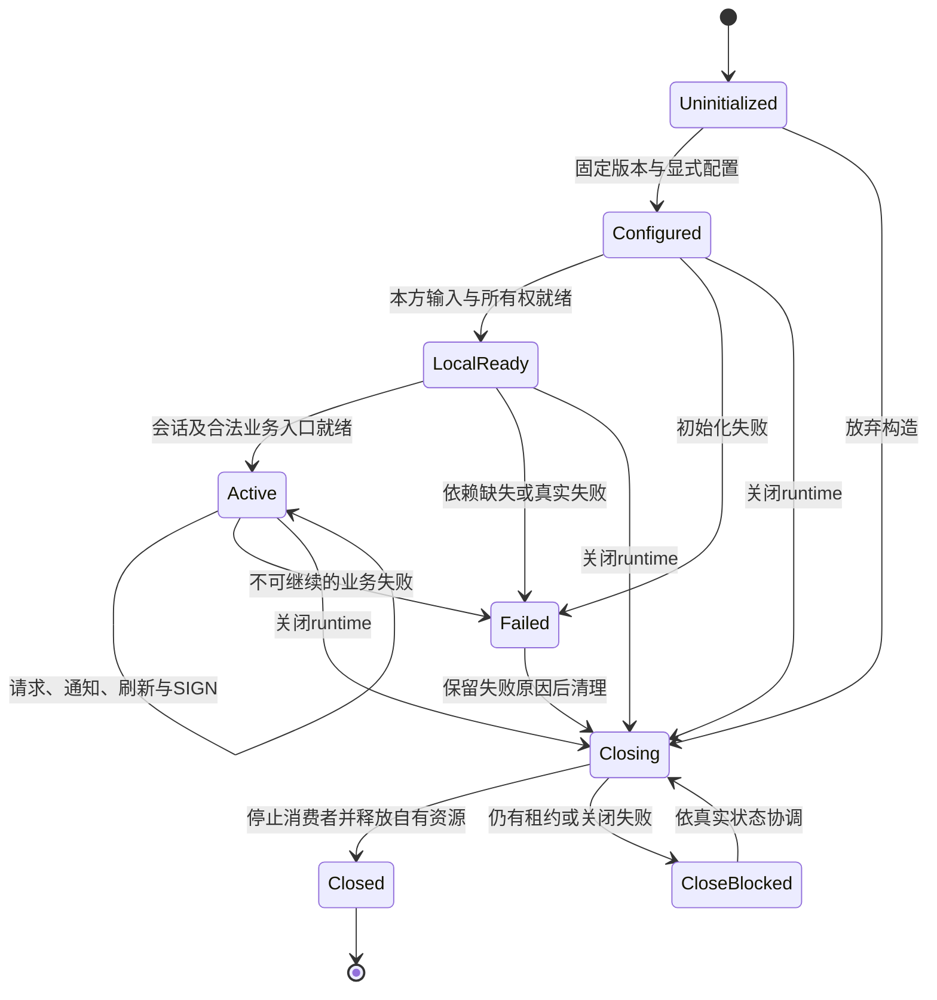
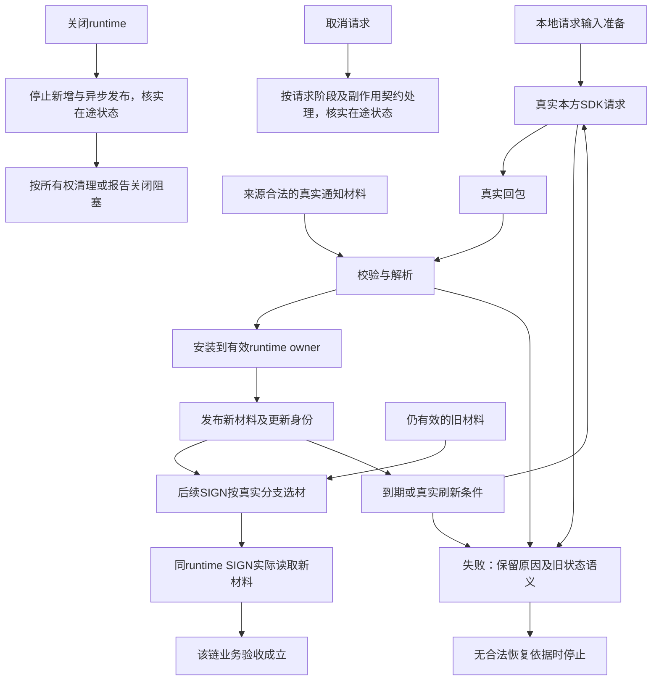

# 签名业务状态机、当前进度与验收

唯一权威标识：`SIGNATURE-STATE`；更新日期：2026-11-25。

本文件是签名业务状态、进度和验收的唯一现行入口。完整 Goal **未完成**。
旧 HANDOFF、报告、输入快照及 Git 历史只作历史证据，不是现行状态入口。
COORDINATION 只记录调度和操作，不另立业务状态机。
原长篇过程记录已由 Git 历史及既有 before/input-versions 快照保留，不再复制归档。

## Own completion 的可观察结果

`complete_own_device_request` 返回 frozen `OwnCompletionResult(outcome, stage, code, cache_updated, publication)`；outcome为failed／processed。stage仅覆盖现有transport、sdk_envelope、sdk_status、auth、material、token_parse、publication路径，code按stage区分namespace，无源数值时为None。非法envelope不再把mode冒充状态码。1003经原状态树规范化后返回failed/sdk_status/1003，保留current及其他pending；不新增retry／refresh／callback／owner关闭策略。

processed仅表示publication wrapper返回，原dict详情完整保留，不代表setter／expire或后续消费成功。真实异常仍抛出并保留部分副作用。旧Pure Own reply MODEL close FAIL不变；没有decoder／receiver接线或新actual执行。证据：`A/overall-signing-service/failure-observability-implementation/`。

## 有限 source cold12 reply 纯解包

`decode_source_cold12_reply(frame)` 接受包含4B总长的单个完整immutable bytes frame，返回frozen `Cold12Reply`：version、encryption、flag、routing、uint32 wire_sequence、int32 status、三个header Strings（command是第二个）、compression、immutable有限extension字段、header_word及payload。总长精确相等是本方wholeframe边界，不声称原decoder本身做了该比较。

已实现received12、type0明文／type2 zero-key TEA＋7zero、BE/L32、GrayUinPro.Check条件skip4、compression0、空extension及源正向证明的top9/21/22/25/27、child1/2小varint＋child3 present-empty结构。值不是私有hash／固定值匹配。其他version／type1／mode、compression、extension重复／类型／group／overflow或多字节值域明确unsupported；畸形支持域抛InputError，未实现源分支抛PrimarySemanticUnavailable。header最后DWORD读取失败的源输出未闭合，也保留精确Boundary。

B已通过独立source review及6项MODEL检查；正式纯decoder现已对保存的真实143B完成CPU-only offline验证，16项逐值比较（header／wire／完整command／20B extension／3B payload等）全部匹配，SSO status0／SDK1003。此证明仅是正式纯解包器处理旧实际bytes，无owner admission／认证／安装／Native／新网络，C receiver编排现已实现MODEL检查，真实owner执行未验证；旧1003根因unknown与Pure Own reply MODEL close FAIL均不变。证据：`A/overall-signing-service/source-cold12-reply-implementation/`、`A/overall-signing-service/source-cold12-reply-offline-actual/RESULT.json`。

## Own cold12 接收编排

`WindowsSigner.receive_own_cold12(encoded, frame)` 现复用原pending identity、encoded wire32／SDK64与原完整command，调用正式puredecoder后精确关联。closed／cross-owner／late／cancelled、畸形／unsupported／不匹配均在stateful fatal scope外拒绝，不消费pending、不污染健康；无新增encoded集合或receiptregistry。SSO0仅调用一次现有public complete并原样返回OwnCompletionResult；非零signed SSO仅public cancel目标，返回failed/sso/真实code，保留其他pending。取消只本地终结；无callback／retry／reSIGN／send／drain策略。

binding active finally始终清理，不嵌套既有public operation；真实complete／cancel异常按原fence抛出，部分副作用不回滚、不转成功DTO。MODEL使用实际Bparser及原pending检查、明确公共操作ports doubles；尚未在真实owner执行该receiver。A15MODEL、B6MODEL／16项保存实际wire offline验证分别复用其原范围，不等于真实认证／安装／发布／后续消费。旧Pure Own reply MODEL close FAIL及SDK1003根因unknown保留。证据：`A/overall-signing-service/own-cold12-receive-implementation/`。

## 整体大签名服务

当前交付形态是 Python 库与 Windows 单 owner 的串行运行时；正常 core 已实现并实际产生 SIGN 三字段，不只是接口外壳。限定当前 C 的入口检索未发现 HTTP 服务；这不是新增 HTTP、部署或池化目标 [OS]。

| 层次 | 当前证据与边界 |
| --- | --- |
| ResultProduced | a7 与一次真实 binder 请求已产生正常 SIGN 三字段；后者逐 bytes 核对并实际进入 frame、发送。 |
| 独立数学 Verified | 完整 SIGN 尚无适用的同输入独立真值。reference/direct 共享 PrimaryRuntime、程序及 host 族，reference 也可进入 direct helper，不能自动充当独立 oracle；限定已知材料未找到可立即执行的完整独立点，不代表全历史不存在。实际 P256 检查因未保存同次 private scalar／sharedX 而停于输入缺口，不是已发现数学错误 [P256]。 |
| 普通业务 Accepted | 仅一次 SsoEstablishShareKey 关联回复 SDK1003，不能证明服务器校验了全部 SIGN，更不证明普通业务命令已接受。 |

SDK1003 的源消息已知为“下游服务失败”，根因仍 unknown；它不是 owner fatal。上次 actual runtime 已正常返回级关闭，不是当前持续运行中的服务，逐 handle 退出仍 unknown [SA][BR1]。B 的真实新材料认证、安装、发布与同 runtime 后续 SIGN 消费未闭环；它可能影响首次及持续 SIGN，不能只称维护路径。源 counter→BA22B0→signed32 十进制临时量已证，但栈槽多生命周期／alias 传播未闭合，seq 的数学消费仍 unknown，既非已证 bug 也非1003根因；不新增 public seq 参数。

当前优先级是材料失败可见性／receiver 接线与有界大 SIGN 正确性并行。Opus 已收到上述三层事实，仅作顾问，未执行源码审查；咨询不代替行为证据 [OS]。完整 Goal 及下列未验收分支保持不变。

## 1. 目标、基线和职责

目标：固定 QQ 9.9.33-52230 源码及当前候选，完成材料 B 全链：
真实本方请求 → 真实关联回包，或来源合法通知材料 → 校验解析 → 安装 → 更新发布 → 选材 →
**同一有效 runtime 的后续 SIGN 实际消费新材料**。
SDK、Token、Qimei、通知回调、protocolTokenHex 异步消费者和空值语义、UIN、
配置、刷新、失败、取消、关闭及所有权均在签名验收范围内。

- 137之前的代码基线：`99611c569deb1688a248734ec7d3b31e7f9cb8c7`；本次137实现的输入与证据见 [W]。
- 完整137正常域候选已冻结；CORE 10 pure 与4项 legacy、WMI 5项与 Windows 5项检查按绑定证据复用 [W]。
- wrapper SHA256：`63112ab9161e127f5f7e17998a7196e143808923fb54cbbf7b4e21426187a5f0`。
- qimei SHA256：`a6100bce0de79ea52fe80a85acce2c24c615306fd3c2dedd119b51b0f26ebcc6`。
- 用户优先本方协议自行产出；不能以历史抓取值或伪造 receipt 替代生产链。
- Claude Opus 领导治理与方案取舍，已多次实际咨询；不是技术源码核验者或逐提交审批人。
- Root 负责工程协调、Git 和唯一调度记录；技术结论由职责执行者提供证据。
- 登录算法由另一负责人维护；签名侧核对会话交接与 SDK 消费，不接管登录算法。
- 既有实际 ONLINE 只属于 experimental51728/protocol12，不可重标为 52230 互操作。

## 2. 阅读证据的规则

`A` 是本地证据根：
`G:/Hackergame/.codex-workflow/reports/pmhq-analysis-20261010/signature-audit-20261119`。
下文 `A/…` 是安全报告定位，不是发布资产或运行时依赖。
不把原始密钥、UID/UIN、主机名、profile 内容或私人捕获路径写入本文件。

| 证据层 | 能说明什么 | 不能替代什么 |
| --- | --- | --- |
| 固定源码 | 语义、调用顺序、依赖与边界 | 当前代码实现、实际执行 |
| 当前代码 | 接线和可表达行为 | 执行成功、真实来源 |
| 受控模型 / pure | 明确输入下的分支和计算 | 真实 OS、COM、网络 |
| 真实本地执行 | 所绑定本方 OS 输入和持久化 | 服务器材料、网络接受 |
| 真实网络 | 所绑定请求、响应与会话 | 解析安装、后续消费 |
| 同 runtime 消费 | 有效 owner 内的更新到 SIGN 因果链 | 其他未覆盖业务分支 |

PASS 只适用于报告绑定的输入、分支和环境；源码变化后按影响判断能否复用。
旧内部 A2 等里程碑、组件 receipt、输出非空或长度改变均不等于完整 SIGN 完成。
下图与安全不变量是**逻辑目标契约**，未证明的边不得理解为已实现或已实测。

## 3. Runtime 生命周期（目标契约）

| 状态 | 进入条件 / 数据 | 退出条件 | 当前证据 |
| --- | --- | --- | --- |
| Uninitialized | 显式新 owner，尚无初始化成功资格 | 有效配置或关闭 | Qimei 局部 cold 合同成立 [Q] |
| Configured | 版本、UIN、配置及 owner 身份明确 | 完成本地依赖或真实失败 | 局部配置模型；整体待验收 |
| LocalReady | 完整本方请求输入与生命周期可用 | 合法会话和入口就绪 | a7本地137→codec→同owner SIGN及返回级close局部达成；算法未证 [L7] |
| Active | 当前会话可用且 runtime/epoch 有效 | 正常运行、失败或关闭 | 正常全 SIGN/SSO SDK 交易未证明 |
| Failed | 保留原错误、阶段和可恢复性 | 合法恢复或关闭 | key25 真实失败及恢复一例 [D] |
| Closing | 禁止新任务，处理已有消费者和租约 | 资源回收或明确 CloseBlocked | a7 owner及4资源close正常返回；逐handle未知 [L7] |
| Closed | 所有自有资源、任务均退出 | 终态；新工作需新 owner | a7返回级close及进程退出成立；完整B仍未证明 [L7] |
| CloseBlocked | 资源仍被使用或清理失败 | 核实后继续清理 | 不得伪报 CLOSED |

目标安全不变量：身份不得跨 runtime 拼接；关闭后不得发布材料或继续消费。
请求取消须按该请求阶段及副作用契约处理，区分已发送、已回包、已安装、未开始；
取消请求不要求关闭整个 runtime，不能把未知副作用改写为成功。
关闭失败须保留仍被租约依赖的资源；这些是待验收约束，非全局已验证结论。

## 4. 材料 B 与 SIGN 生命周期（目标契约）

| 材料状态 | 进入条件 | 退出条件 / 数据 | 当前证据 |
| --- | --- | --- | --- |
| InputPrepared | 真实本方输入完整 | 编码并经所需 SIGN 发请求 | 本次同owner binder/SIGN/frame一次sendall，command/body/SIGN3/sourcefresh字段逐bytes匹配；a7原无网络证据保持原作用域 [L7][BR1] |
| RequestPending | 适用的合法传输 context、完整载荷、真实发送 | 真实响应或明确失败 | 一次发送并收到首143B响应；SDK错误1003，不是正常材料交易成功 [BR1] |
| ReplyReceived / NotificationReceived | 真实请求关联响应或来源合法通知材料成立 | 直接校验、解析或拒绝 | raw reply的wireseq/cmd匹配；20B extension源接受未知，payload服务错误1003，无材料密文；通知路径未证明 [BR1] |
| Parsed | 格式和业务条件满足 | 安装到正确 owner | 单独 parser 不能算安装 |
| Installed | 新材料写入当前有效 owner | 发布并可供选材 | 尚无完整真实证据 |
| Published | 更新对实际消费者可见 | 后续 SIGN 真实选中 | queue/cache 写入不充分 |
| Consumed | 同一有效 runtime 后续 SIGN 读取新材料 | 记录因果证据，完成该链 | 尚未证明 |
| RefreshPending | 真实刷新条件、有效 owner | 更新成功或真实失败 | warm 行为与失败分支待全链验收 |
| Failed / Cancelled | 原因及在途副作用可诊断 | 仅按合法契约恢复 / 关闭 | 不用默认值伪装成功 |

SIGN 既是 SDK 交易的前置依赖，也是新材料的后续消费者；不能循环假定二者已成功。
本地设备值、17B、Qimei、SDK metadata/token、protocolTokenHex 是不同数据来源。
关系未证时不得等同，不能用其中一种填补另一种缺口。
刷新失败或空值是否保留旧材料须逐类遵循已核对契约，不能套一个全局兜底。

## 5. 当前已知进度与边界

### 本方本地输入

- `fc79bb8` 的 own cold 17B producer 使用真实 OS、12×4 RNG、6 次 steady 及实际容器地址。
  独立观测重算一致，资源归零 [M]；它是本地加密输入，不是服务器新材料。
  不得拼接不同 PID 捕获来声称 sameRuntime。
- `9af1040` 的 key25 本方 producer 实际使用 494 对象名、1 display 及已有 CAPI method6。
  完整 value/checkpoint 的独立数据流重算一致 [D]；原 QQProtect 与原文件未改。
- key25 a1 因错误 `_rand_s` 真实失败并留下 0B checkpoint；修为 canonical `rand_s` 后，
  a2 在同 root 恢复为有效 1028B，未删状态或另造 cold [D]。
  RESULT 的初始 offline not_run 字段不替代随后 DATAFLOW 的独立重算结果。
- CAPI method5 创建/null DACL 未授权、未 actual；profile fallback 未 actual。
  不得把权限拒绝吞为普通失败后强行走 fallback。

### 同owner共享设备值

- `owner.get_own_device_value() -> bytes` 经 WindowsSigner 原 `_operation`、PrimarySigner `public_call`
  调用 `caller_device_value(runtime)`，返回 owning bytes；它与正常 SIGN 使用同一 SLOT6751838 cached_value/1BE77F0。
  业务collector必须使用该getter返回值作为record25输入，不把provider d/token当设备值，也不注入factory缓存。
- actual a2 standalone producer 返回success并不证明其结果已发布到owner singleton；standalone own-state与owner client根不同，
  时间与rand_s header也可不同。当前结论是共享未绑定、可能不同，未观察到实际mismatch；既有独立producer算法证据仍有效。
  薄getter在a3已返回；a5返回137但SIGN未完成。Native819未覆盖输入仍保留Boundary，不绕guard。
- 存储仍沿用owner factory的显式DirectoryCheckpointStorage root；实际运行须绑定已有可信ownG root并保持
  `allow_capi_creation=False`。既有API允许显式opt-in，路径校验并非全局G盘限制；getter未增改该政策。
  既有WindowsCapiObservations在禁创建时拒绝0x68/GenKey及安全描述符/ACL/SetProvParam创建路径。

### Qimei 与 SDK 缓存

- `99611c` 的 QimeiGetterOwner 显式 UNINITIALIZED：ready0、module0、70B cache 零。
  get 合法 empty，不入 DLL、不 auto-init；不是原 QQ 正常 startup 或已初始化 a2 [Q]。
- fresh SDK config58 的源 constructor 独立零写；非空才 copy，empty 不清 warm 旧值。
  共享 SDK records27/28/89 已接入，3 pure PASS；不是完整 Qimei 或真实服务器接受 [Q]。
- initialized b 主段取 main record1、最多36B；aux32 的 690A5 未闭合。
  CONFIG refresh 两次，startup/cache 恢复另属 a2；这些未知仍是 Boundary [Q]。
- 全新 SDK metadata cache pair24 由真实源 ctor 清空；成功解析且 token 非空才更新。
  失败或 empty 不清 warm metadata；它不等同 Qimei、17B 或 protocolTokenHex [S]。

### 完整137与 Windows composition（正常域源码及受控集成已通过独立 review）

- CORE 最新执行者报告：受控 normal cold 8 WMI row/longString、
  真实 parser 选择非空 adapter、WLAN22 cold 默认1、ordered137 到既有 encoder 已贯穿。
  warm 仍 refresh；正常域源码及受控集成已通过独立 review，CORE 10 pure 与4项 legacy 检查成立 [W]。
  这些受控结果不是 genuine137 或真实 OS 采集证据。
- Windows composition 已接入既有 random_device/ANSI helpers，5项纯检查成立 [W]；
  actual a2 已进入初始cold snapshot，但止于 GetCursorPos 观察缺失，未取得真实137 snapshot。
- WMI 有5项 fake ABI 检查及独立 review：invalid BSTR 不得 clear，失败 clear 不得 retry。
  它们不证明真实 COM 已执行；阶段安全证据在 [W]。
- adapter ordinary failure 域未实现：ipconfig/all 备份 parser 与第三 backend 仍未知。
  primary 返回 AL 非零不触 fallback；真实 OS 触发未覆盖域时应 Boundary，不能强成功或空 adapter。
- identifier keys72..76 涉及 delete installStatus、3轮补读、FILETIME、randomdevice/MT、
  硬件 strings，以及 raw/digest/double 生成和配置/cache/installFlag 写入 flush。
  OWN_STORES 使用显式 G 配置/XML cache 与本方 HKCU namespace，不冒充原 QQProtect。
  actual a2 未完成137；原 HKCU Tencent QQProtect 删除或写入不在本方路径授权内。
  XML 声明/comment 等未支持输入保留 Boundary，不伪装为空。

### 本方 cold provider/bootstrap 入口

- `open_windows_signer(..., own_business_config={'uin': uint64_int, 'machine_id': persistent_bytes})`
  显式选择本方 cold profile；`host_profile_string` 必须为 `b'V1_WIN_NQ_9.9.33_52230_GW_B'`，
  必须使用 direct backend 与 owned worker bridge；与 outer login、diagnostic metadata 互斥；可选 construction hook 保留在业务初始化前执行。
- 从本方 UNINITIALIZED Qimei getter 取得合法 empty，固定源默认 QUA、规范 UIN ASCII、
  required 非空 NUL-free machine_id 构建既有 ProviderInitializationMetadata；不恢复原 QQ effective profile。
  machine_id 是本方持久 caller 配置，provider 与后续 SDK27/login handoff 须保持同值。
- 业务及 diagnostic 分别调用共有 provider-init/Host129 primitive，保留公共 owner operation fencing、
  pending bootstrap 检查及失败清理；不调用 diagnostic prepare 后重标状态。
  actual a2 的业务初始化已返回（控制流证据），不证明 SDKReady、材料安装或 actual SIGN。
  refresh/complete 仍用原公共入口；notify/update 公开映射仍未证明。

### 本方独立 cold SDK request component

- own-business owner 可经 `initialize_own_sdk_request(request_capi=..., clock_inputs=..., random_environment=..., state17_owner=..., transport_context=...)`
  一次绑定，再以 `create_own_device_request(records)` 经原公共 operation fencing 构造请求。
  clocks 显式包含 wall_seconds/monotonic_ns/clock_ns；生产环境借用 SystemRequestCapi、真实时钟及
  WindowsDeviceValueEnvironment.random_bytes(4) 的 canonical rand_s；不使用测试熵或 secrets 替代源证明。
- component 自持 fresh flags0、counter1、zero168B material及连续 MT；不是原SDK receiver/pending资格，
  不访问 receiver_state、不创建原pending、不重置warm metadata。绑定确认实际SDK cache+24 empty，构造时重读当前metadata及feature46。
  命令及getToken解码沿用固定源语义；先编码并固定decode snapshot，再type选择，最后取旧SDK序号并递增。
  编码/type失败不提前消耗SDKcounter，已发生material/MT变化不回滚；当前transport None不表示网络可用。
  feature46 ON要求同owner state17 producer及实际PID/clock/formatter状态，OFF不调用cipher。
- clock/CAPI/observation接口为借用，不由component关闭；client关闭component逻辑生命周期。
  a7已完成实际请求codec及同owner sign_result，输出结构已核且返回级close正常；内容/算法未证，notify/update及完整Goal仍未完成 [L7]。

### actual a2 与 cursor 窄绑定

- actual a1 startup 失败历史保留，不重标为业务完成。actual a2 已返回 owner factory/business初始化、
  SDK cold fields 校验、key25 success、17B producer 和 public request初始化；这些是调用返回证据，
  不是每份材料独立重算。collector已进入初始cold snapshot，GetCursorPos缺观察使其停止；137未完成，encoder及policy2 SIGN未到达。
- 独立 collection `take(data, 'GetCursorPos', ())` 现绑定 lazy user32 GetCursorPos(POINT*)：
  native BOOL + 成功8B POINT（两个signed LONG32）；BOOL0仅返回空effect，不把默认缓冲当真实坐标。
  GetLastError保留在cursor observation；composition负责其自有DLL引用关闭。新增绑定仅经mock FFI及真实consumer相关copy语句检查，未actual查询光标。
- a2所有owned进程已reap、CIM剩余0；close路径被调用，但逐资源关闭未instrument，状态unknown，不能报资源0。
  STATE-SUPPLEMENT仅检查当前attempt树，未识别ownstate/config/cache文件；持久材料可复用性unknown，
  不证明全局不存在，不据此任意创建fresh状态。后续实际运行须另有具体授权并核对可信状态。
  安全证据：`A/own-business-bootstrap-a1/independent-live-a2/{BOUNDARY.json,STATE-SUPPLEMENT.json,RESULT.json}`。

### actual a3 FILETIME frontier

- actual a3 的 `owner.get_own_device_value()` 与 GetCursorPos 已返回（trace控制流证据，非独立材料验证）；
  collector cold snapshot下一处 GetSystemTimeAsFileTime 在composition.filetime因返回形状检查触发InputError。
  真实值未投影，不能断言观测了错误时间。137、encoder、policy2 SIGN均未到达。
- 源码定位：既有native backend按void ABI写入8B缓冲，返回 `(None, (raw8,), error)`；
  SYSTEM/PROCESS ports保留单缓冲tuple，composition原先错误要求flat bytes。filetime现严格解包一个8B输出effect，
  仍要求void None、真实8B，不填零、不更改底层ABI或失败语义。新增mock kernel FFI→backend→SYSTEM→PROCESS→composition检查通过，未actual运行修复。
- a3三个owned进程RC1并reaped、CIM剩余0，515项输入未变；close路径调用但逐资源关闭unknown。
  证据：`A/own-business-bootstrap-a1/independent-live-a3/RESULT.json`。
  后续须另有具体GO并复用可信ownstate，继续遵守ownG与 `allow_capi_creation=False`；完整Goal仍未完成。

### actual a4 与 printf options0x24 有限支持

- actual a4 collector已返回137条且count检查通过；这只是控制流及数量证据，未独立验证内容/顺序。
  actual feature46为ON，record cipher在formatter options非零guard停止；编码未完成，policy2 SIGN未到达，逐资源close细节unknown。
- 固定源printf options存储正常attach为OR0x24；RecordCipherHost现仅接受exact int 0或0x24。
  legacy-wide与standard-rounding bits对当前完整容纳的窄 `%d` signed32输出不改变字节/长度；
  其他options、其他格式、容量不足仍Boundary，不扩大截断语义。完整cipher受控0/24输出一致。
- own request ON路径调用既有 `primary_crt_stdio_options.read_options(runtime)` 获取当前qualified值，
  保留birth/backing/phase/liveowner-thread-epoch检查，不直接load或默认0。修复仅pure验证，未actual运行。
  源依据：`A/mmkv-stdio-state/RESULT.md`、stdio-getter-consumers、stdio-options-ref-closure；
  SDK10.0.26100 corecrt_stdio_config.h的04/20位定义。完整SDK/Token/Qimei异步链及Goal仍未完成。

### actual a5：请求codec完成，SIGN与正常close仍未完成

- a5实际返回137、request encoder完成，并以同owner的request.command/body进入SIGN；
  701774整数formatter因正常global options0x24被拒绝，SIGN未完成，未取得完整SIG。
- 后续OFFLINE-DATAFLOW已核对137 key顺序/schema/types、两个records快照相等、cold command选择、
  初始ordinary SDK序号、immutable168B decode snapshot及body/encoded wire结构关系。
  它不证明独立body解密、记录值语义、服务器接受或完整签名；初始RESULT中的offline not_run不替代后续检查。
- a5 cleanup实际因缺少unsuspended lease失败，最终进程AV退出（-1073741819）；CIM0仅证明进程消失。
  资源释放为failed/unknown，AV因果仍unknown。源码核对定位：stop_checkpoint在suspend内部restore，
  creator_closing在closing lease退出后restore，均不满足既有lease语义。
- 当前close候选只调整两处restore顺序，不改HostServices验证/counter、回调重试或模块释放规则；
  2个pure方法/7个subcase及独立review通过，已随6b4f6f交付；a6未报告旧lease错误，但close仍失败，不能据此宣称AV因果已闭合。
- main701774现从qualified read_options取得GLOBAL exact0/0x24（wrapper有效2/26），
  仅支持精准窄 `%d` signed32、完整容纳、非重叠及NUL语义；未知位/格式/截断仍Boundary。
  3项pure及独立review通过，已随6b4f6f交付；a6的SIGN返回事实另见 [L6]，原完整stdio fixture的PTD失败不是pass。
- 证据：`A/own-business-bootstrap-a1/independent-live-a5/{RESULT.json,OFFLINE-DATAFLOW.json}`、
  `A/own-main-sign-printf24-a1/`、`A/own-failed-close-lease-a1/`。
  a1至a4原记录及证据保留；该离线候选当时不包含C外crashhandler支持，也不授予后续运行权限。

### actual a6：SIGN返回且结构已核，response cache material String关闭失败

- a6 full137及request编码已返回；同owner `sign_result(request.command, request.body)` 已返回，
  结果artifact已保存；offline只读pickle opcode核对确认为PrimarySignatureResult，非pending/None或空物料 [L6]。
  source字段sign96B、extra12B、token141B均为非空bytes，各≤255B；当前类型无protocolTokenHex字段，外部映射未验证。
  这仅证明实际返回及source字段结构契约，长度匹配不等于SIGN算法正确；内容/算法语义及server接受仍unknown。
- 首个cleanup失败位于provider cache destroy_cache → _destroy_string → current runtime `_free_allocation`，
  报告待释放对象不是当前runtime拥有的allocation。已定位为provider response cache+0x18的material value String，
  不是singleton device value本体。源契约要求long>22B独占deep-copy或explicit move；当前受控RCA已确认 response cache 长字符串属于 upper allocator，原析构误走 lower runtime heap free；固定源 BCD2D3 → B75029 支持匹配 upper delete。现已复用 `_String.destroy()`，纯模型回归通过；a6 实际指针家族与非法指令原因仍 unknown，不能外推实际关闭已修复。该修复当时等待独立审查与Root后续授权；其后a7结果见 [L7]。
  先前main temporary cleanup疑点未获实际allocation身份链证明；受控upper/lower析构归属结论不等于a6实际fatal RCA，保留_free_allocation guard。
  不绕freeguard，不把进程消失当作正常close；资源状态FAILED/UNKNOWN。
- 最终退出-1073741795（STATUS_ILLEGAL_INSTRUCTION）；三个owned进程均reaped、CIM0。
  faulthandler文件0B未给出具体nativepoint；fatal原因unknown，不能断言由freeguard导致。
  a6未报告旧lease错误，但不能推广为所有关闭路径已正确。
- a5 offline [L5]的137 schema/order/types、快照相等、request cold command/seq及immutable168B结构证据
  仍只适用于其绑定artifact；a6 records schema/order未另核。记录值语义、独立body解密、server接受仍unknown，不能由SIGN结构验证推导。
  本地“SIGN返回＋正常close”双条件仅前半的控制流达到，完整材料更新→安装→后续SIGN消费Goal未完成。
  当时Native a7 HOLD；后续另获授权的a7结果见 [L7]，不改写本次失败历史。

### actual a7：本地SIGN返回与正常close局部里程碑

- a7 verdict为PASS_LOCAL_MILESTONE：137→request encoder→同owner同request.command/body的SIGN结构结果返回，
  owner.close及四个resource.close均无异常返回，complete/cleanup_ok为true [L7]。
  三个owned进程均RC0、reaped、CIM0，无timeout/retry；515项输入不变并复用同profile/state roots。
- offline结果结构为非空bytes的sign/extra/token（96/12/141B）；逐handle计数未知，debug fd保留至进程退出。
  这是LocalReady层本地局部达成，不代表Active材料业务完成；当前records schema/order未独立核对，
  记录值语义、137内部cipher、key derivation、SIGN算法、server接受及安装→后续SIGN消费仍未证明；请求AEAD另见 [AE7]。
  a6的关闭失败及fatal原因unknown保留为历史，不因a7正常退出反推其因果已证。

### SDK、异步消费者与登录

- 四 SDK 命令均消费完整 payload；status0 也加密 payload，没有纯握手空 body 捷径。
  四者均 policy2 SIGN，无合法免签证据；codec 可表达 None 不等于许可 [S]。
- protocolTokenHex 的实际异步消费者、Native12 或 V8 绑定未闭合。
  None、空、非法值不得默认补值；SDKToken 与 Qimei 等关系未证。
- SsoTransport 代码存在不等于整体 SDK、真实网络、安装到 next SIGN 已验收。
- 登录独立 owner 的历史 ONLINE 仅属于 experimental51728/protocol12。
  旧 a6 WMI checkpoint 失败既不证明 native Next 永久挂死，也不证明正常 own137 已通过。

## 6. 原范围验收矩阵

| 范围 | 必须取得的业务证据 | 当前状态 / 最早缺口 |
| --- | --- | --- |
| 固定版本及当前候选 | 固定52230源、候选身份与执行绑定 | 源码基线固定；137正常域候选已冻结 [W] |
| 本地17B | 真实输入、独立重算、资源退出 | 局部真实 PASS [M]，非材料B |
| key25 | 完整生产、持久恢复、真实分支 | method6 局部真实 PASS [D]；其他分支未 actual |
| 完整137 | 正常采集到编码的真实完整输入 | a7返回137；a5 offline schema/order/types仅适用a5；a7当前schema/order及值语义未独立验证 |
| SDK请求 | 完整载荷、所需 SIGN、真实发送 | 一次真实 binder frame／正常SIGN／sendall已完成，command/body/序号/SIGN3及fresh字段逐bytes匹配；服务返回1003，算法正确性/全交易未证明 [BR1] |
| SDK回包 / Token | 真实关联回包、校验、解析、安装 | 首143B raw reply的wireseq/cmd匹配；SDK错误1003，无材料密文；实际20B extension已获固定源正向结构／getter接受证明，production decoder未接，未认证安装 [BR1][E20] |
| Qimei | cold / initialized / restored 各自真实契约 | cold 局部受控 PASS [Q]；完整更新未证明 |
| 通知与回调 | 来源合法、注册、分发、生命周期、安装 | 完整真实通知路径未证明 |
| protocolTokenHex | 异步真实消费者及绑定、空/非法语义 | Native12/V8 等未闭合 |
| UIN与配置 | 显式配置到实际消费者，身份一致 | freshOptions源投影及本次已安装machine identity进frame逐bytes匹配；UIN/warm/完整运行仍不足，不输出原值 [BR1] |
| 刷新 | 真实触发、更新、失败保旧语义 | 仅局部源/受控证据 |
| 失败与恢复 | 原错误可见，同对象恢复且不伪成功 | key25 一例 [D]，不外推全域 |
| 取消 | 在途状态明确、停止异步副作用 | 本次local cancel正常return，不代表外部网络已中止；全业务路径待验收 [BR1] |
| 关闭与所有权 | 有序停止、自有资源退出、租约正确 | 本次socket/owner close正常return、进程退出/drain完成/debtfalse，逐handle未知；旧Pure Own reply MODEL close FAIL仍保留，不覆盖全生命周期 [L7][BR1] |
| SIGN消费 | 同runtime选中新材料并实际读取 | 未证明，最终关键门禁 |
| 登录交接 | 合法会话交给签名owner，版本不混淆 | 另owner；51728不证明52230 |

## 7. 最早断点、下一步与完成标准

当前同owner本地SIGN结构返回＋正常close的局部里程碑已在a7达成 [L7]，范围NO_NETWORK。
`c7226cf` 引入有限 reply complete/cancel 入口，后续 fresh binder 已完成一次真实同 owner request→prepare wirecounter→原正常 SIGN 一次→frame→一次发送并收到首个响应 [BR1]。独立读取保存数据确认 command/body、wire32／SDK64、SIGN三字段及sourcefresh配置 bytes 全部匹配，不是长度比较。**当前最早观察到的业务失败是 SDK 服务错误1003，源消息“下游服务失败”、根因 UNKNOWN**；实际20B header extension已有静态正向接受证明，但production decoder接线仍缺，尚无新材料认证／安装／发布／后续 SIGN 消费。不能推断 SIGN错误、必须登录或AppID错误。
当前策略是材料失败可见性／receiver 与有界大 SIGN 正确性并行；1003不被归因于未证的KDF、137cipher或参数错误。实际20B extension的静态证明不等于production接线，不恢复通用proto/zlib、不换appid试错，修复或明确证据假设及Root新GO前不再发网 [OS][SA][E20]。
a7实际请求AES-256-GCM已用独立cryptography AESGCM完成认证解密并匹配保存plain，wire加密字段与保存ciphertext一致 [AE7]。
该PASS只覆盖一个实际request AEAD边界，不验证key derivation、137 cipher、SIGN算法或server接受。
无适用同输入SIGN真值且a7缺完整运行观测；Opus在新事实下撤回全SIGN真值前置闸，停止扩fullSIGN捕获，
SIGN正确性保持unknown待真实参考/服务器结果。AEAD证据、未实现的 exchange 草案和已实现的有限 reply 入口分别说明如下；咨询意见不作行为证据。
旧 `A/own-full-device-records-a1/live-prep/PREPARED.json` 仍为prepared=false，不用于真实GO；后续实际运行仍须具体授权。
不得把独立component当作source native pending/SourceEpoch receipt资格，也不以输出长度替代算法正确性。
Token/Qimei异步消费者及空值、UIN/config、刷新失败、取消和完整关闭验收仍未完成；两图目标契约保持。

### signed exchange 草案与既有 authenticated 交接

尚未实现的概念签名：`exchange_signed(command, body, sdk_sequence, sign_result, transport_context, deadline)`
返回真实关联的response bytes、command、SDK sequence，或保留实际阶段/在途副作用的错误。
请求及SIGN必须来自同一有效owner；发送保存的同一command/body及签名，不重SIGN、不走旧receiver admission或drain，
不默认补材料、不自动重发或跨runtime拼接。wire sequence必须明确映射到SDK sequence并检查expected command；
超时/取消区分未发送、已发送未响应及已响应，唯一IO owner负责接收/路由、deadline和关闭，不能把unknown当成功。

固定 52230 cold SDK 是否必须先认证登录仍为 **UNKNOWN**，SDK 层未见 D2 检查。
receiver `1BE3060` 接收外部 context；`1BE2F90` 调用参数是 `(command_cstr, body_ptr, uint32len, uint64SDKseq)`，
没有可当作 send-success 的 BOOL。固定 callback producer 已有源链：`72B078/72B70A/72B7DA` 经
`B9E850→1BE3060` 注册 `72B142`，再到 messenger weakref／VT30；正确 factory `B7C6C0` 对应
`MSFMessengerImpl` 的 VT30=`1B4E19E`（旧 `72EAF0` 归因已失效），发送经 `B7CE8A` 的状态4/5拒绝分支，
其余到 work `B7F7B2→D32138`；回包 callback 到 `BA20A0→1CE9930`。
`B7F7B2/rawB7EBB2` 只构造 callable 代码／管理记录，不是 SSO writer。
后续选中路径已恢复到 fixed52230 的 fresh cold/type2 writer：实际 outer=12，两个 cold SDK 命令使用 type2／16字节零 key；这仍不是服务器接受 prelogin 或必须登录的证据。
源证据：`A/OWN-SDK-RECEIVER-CALLERS-AND-NONJOIN-20261124.md` 及
`A/sdk-receive-registration-maps-source-a1`、`A/sdk-session-messenger-factory-source-a1`、`A/sdk-messenger-send-source-a1`。
当前参考 SSO 实现允许 session=None；非 `A2.o3.ecdh_access` 分支使用 encrypt_type2 零 TEA、不携 D2。
该实现源自参考 LLOB；目前 fixed52230 的 packet grammar、reserve 字段及 signature DTO 顺序已有源契约，不能因此沿用参考 profile 的业务值。fresh ordinary 分支的 Node initConfig→72EC24 producer 现已恢复，下述 binder 可从同 owner 已安装身份及显式业务 env 选择推导字段，不再要求调用方提供9个 opaque 字段；
既不能据此强制 authenticated live/D2 前置，也不能反称服务器已接受 prelogin。

现有 `primary_source_cold12` 为 fresh cold/type2 的 required-input 编码实现，不发送网络；本轮修复其与 Own 请求之间的真实命令入口不匹配：
固定表精确支持 `trpc.o3.ecdh_access.EcdhAccess.SsoEstablishShareKey` 与 `trpc.o3.ecdh_access.EcdhAccess.SsoSecureAccess`。原 encoder 错误接受裸名、拒绝 Own 完整名，已用 MODEL required inputs 复现并修正；4项受影响 MODEL 方法通过，prepare／encode 保留原 command/body，不在 SIGN 后 strip 或 alias。裸名及 A2 命令不是此 type2 encoder 的适用分支，仍显式拒绝。
`prepare` 先分配 source old-DWORD counter，调用方随后对同一 command/body SIGN，再将当前 `PrimarySignatureResult` 显式交给 `encode_signed`。
counter 取一次成功4字节熵作 little-endian seed，复用源匹配 MT624/397、low24拒绝采样到1..10M，再原子取旧值并 DWORD 回绕；它不是原 SDK uint64 关联号，也不引入新的 SIGN 数学序号参数。
已证 fresh 常量限定在该路径：route数字0保留空 String，非零转无符号十进制；peer A0／request reserve overrides absent、R flag0、K 两个 String 空。
Inner head 使用 `zero10 || hostMarkerBYTE || zero1`，保留 required options／reserve 的 absent 与 present-empty；signature PB1/2/3 为 sign/extra/token，原 adapter 未改。
TEA 保留16轮／big-endian／双反馈链／长度与随机首字节高5位规则；本轮另补解密末7字节必须全零的源校验。旧实现对8组确定性 last-byte-XOR1 损坏密文全部误接受；修复后8个 valid control 与8个 malformed tail 的 MODEL 断言通过，非零尾报 `SSO_TEA_PADDING`，不改变原空值／pad规则。调用方必须提供真实熵与 host producer，不能拿 MODEL bytes、51728 profile 或全空配置当52230实际输入。
Windows 输入 producer 复用既有模块／熵后端：两次独立 version 查询，GAA family2／23、flags80、一次6F resize及仅 node+D0→entry+10 的选中地址。已证明的正常转换域可直接判 IPv4=True（含0.0.0.0）、IPv6=any(address16)，不误排除::1、不以文本库猜测；非法 backing／非正常域显式 Boundary。padding 独立成功4字节 seed，每个随机字节消耗一个 MT word，不池化 word bytes；owned 与 borrowed 资源分别关闭／保留，构造失败释放已拥有资源。实现阶段的完整 MODEL API doubles 之外，独立本地 producer 检查现已通过 [LC12]：两次 GetVersionExW 成功，GAA AF2／23 均状态0，host marker=1；真实一次成功4字节熵驱动的 source counter 初值范围／递增检查通过。owned backend close 正常返回，逐 handle 回收状态未测。此结果仅覆盖本地 host／counter 输入 producer，不证明真实 frame、padding 熵、SIGN、服务器、安装后消费或完整关闭；该次 actual 尚未覆盖后续新增 binder 或实际 frame，不能外推现行绑定／发送成功。
源证据为 `A/cold-sdk-writer-trace-a1/selected12/` 的 packet-byte/head/signature/request/crypto/host-marker/host-conversion 契约，候选检查见 `A/source-cold12-encoder-a1/`；这些不证明实际 profile 已绑定、packet 已发送或服务器接受。

fixed reply 的源 frame 规则已有静态恢复：实际 decoder 输入包含总长前缀，先按接收 version 选类，本方有限目标仅 version12；response command 是第二个 header String，不是第一个。fresh class 仅对 `GrayUinPro.Check` 且 head 后 remaining>=5 时跳过4字节，其他分支不跳；TEA 解密／尾校验已有源依据与修复。参考 parser 的去前缀输入、head形状及宽松切片不能冒充该 fixed 合同。压缩虽已识别 zlib 路径及10／20／40／80倍尝试，精确失败 status 映射的等价接入、非空 extension 动态 ReadTag／group／typed getters 的接受条件仍未完成；不能以 empty-extension 的局部接受证明整个 decoder。有限 fixed reply 纯decoder现已实现并通过保存实际143B的offline逐值对照；通用decoder／signed exchange已新增有限owner receiver编排但尚未真实执行，不把一例command匹配外推为服务器所有回复命名契约。
证据：`A/cold12-signed-exchange-a1/command/`、`response/{RESULT.md,frame,tea,extension}`；命令修复及 TEA 尾校验实际 MODEL 证据分别在 `command/fix/` 与 `response/tea/fix/`。

fresh options 已找到真实 producer，旧 config-source 终点③及 input-audit unknown 被 `A/cold12-signed-exchange-a1/fresh-options-producer/RESULT.md` 在该 fresh 分支上明确 supersede。Node `initConfig` 的 machineId 非空时直接 copy；空值走未实施的 Composite MachineGuid 分支，不生成替代 UUID。appid typed None／0 取源 fallback `0x20067C69`，uint32非零取自身；不实现未证 JS 字符串词法。String8 空、field16 absent、field26 present101、fresh route0 均有源生产依据。两条实际注册 listener 的 VT8 都为28F0 RET，NativeOptions records absent，所以 field21=False／records=() 可在该 fresh itinerary 内部推导；不延伸到 warm／其他 manager。

本方 `bind_own_cold12(inputs, own_inputs=..., appid_override=..., env_setting=...)` 仅接受成功 own-business setup 后捕获的 immutable metadata.field20；不重读 caller dict 或直接读取 profile。machine bytes 必须非空、无NUL且可严格 UTF8 roundtrip，不支持即显式拒绝，不.hex／容错 decode。env 必须显式 DisabledEnvironment 或 EnabledEnvironment(host,port,sso_env_id,canary)，port 是 typed uint32；自算 active=(host非空且port!=0)或canary非空。inactive／disabled 输出 field13=None、field32空；active id非空才使13 present，canary保留空值。没有 readsuccess/active receipt、config.env.json IO 或全默认 Own profile。

`encode_own_cold12(originalrequest)` 先用真实 pending 资格检查及绑定配置，再 prepare 消费 wire32，调用一次原正常 owner.sign_result（同 command/body），再 encode，返回 RAM-only frame／wire32／SDK64／原签名 DTO。SIGN 不处于嵌套 `_busy/_operation`；输入端口阶段 busy fence 防止重入，counter 不回滚、不重试，不更改 SDK pending／假称发送。binder 仅管理自己的 encoder 与显式 owned inputs；关闭早于后端卸载，失败保留真实 cleanup debt，borrowed signer／SDK component 不关闭。MODEL 证明支持域的投影、身份、次序和资源行为；随后一次 staged actual 已证明 binder frame 正常 SIGN 字节被实际消费并发送 [BR1]。这不证明服务器材料接受，亦不将本次已安装 identity 的匹配倒推为历史 a7 profile exact binding 相符。证据 `A/cold12-signed-exchange-a1/{listener-effects,fresh-binder-contract,binder-implementation}/`。

本次 staged probe [BR1] 使用既有 Own profile，不改配置／identity；frame完成后仅一次 DNS first-address、connect、sendall，收到首143B一chunk，无extra、超时或重试。socket close、local cancel、WindowsOwner close 正常return，子进程RC0/reaped、draincomplete、debtfalse；逐handle计数仍未知。实验 endpoint `msfwifi.3g.qq.com:8080` 来自既有 canonical51728 connector，仅为本次实验选择；收到SSO header status0不反推52230通道、算法或材料业务成功。
离线源布局读取：len/version12/type2/flag0、zero-key TEA＋7zero通过，wireseq／完整cmd匹配，SSO signedstatus0、msgempty、compression0。实际extension20B的通用诊断shape为9varint、21varint、22bytes6（nested1var/2var/3bytes0）、25var、27var；在正常分配／copy前提下，该固定20B的NativeReadTag／group／getter路径已有源正向接受证明；未执行Original parser，productionfixedparser仍未接，不外推通用protobuf等价 [E20]。payload仅3B，源派生envelope field2 uint32=1003、无field1材料密文，是非零服务错误路径，未执行材料认证／安装／发布／消费。1003的源消息为“下游服务失败”，根因未证；静态接受证明不是材料认证或服务器成功 [SA][E20]。

major.node cachedData 旧证据仍只覆盖 startup，不是本次字段生产的证据；不再将已恢复 fresh fields 挂在 opaque cache／外部声明缺失上。warm update、空 machineId MachineGuid fallback、其他 MSF selection 及真实端到端发送仍未闭合；不是整包没有 producer 或所有字段都在 V8。

现有 `SsoTransport` 的 protocol12/legacy receiver 接线会在 enqueue 重 SIGN 并 drain，
不能直接用于发送 Own 组件保存的 SIGN。下层 `SignatureBytes.from_primary_result`、
`build_service_packet/parse_service_packet/split_frames` 与 `SsoSocket` 可作后续接线候选，不等于已接通。
来源：`primary_sso_transport.py:50-82/90-128/209-244/283-303`、`primary_sso_codec.py`、`primary_sso_socket.py`。

已有 authenticated 载体交接代码，不能再描述为“没有任何 handoff”或必须移交活 socket：
`run_authenticated_sdk_session.py:432-439/501-520` 要求 ONLINE、恰好一次 RAM material 回调；
`:531-543` 正常关闭登录资源，`:561-579` 以 `network.connect_sdk` 新建 `AuthenticatedSdkSession`。
登录侧 `L/registration_overlay/resident_run.py:148-153` 仅在真实 ONLINE 且 bound 相符时调用 `on_authenticated`，
`:175-177` 明示原连接已关闭。这是一次性 RAM 凭据 → 新 SDK connection 的交接合同。
它仍属于 experimental51728，`AuthenticatedSession` 强制 51728；
`A/authenticated-sdk-integration-a1/RESULT.md` 只有代码证据，没有本项 actual QR/network/factory 运行证据，不能证明 52230 互通。

**采用该 authenticated 载体路线时**，外部一次性交接清单如下；它不是固定源 cold SDK 的唯一已证前置：

- 登录 owner 提供合法已有 RAM session/context/profile 材料及版本、有效期、UIN/config 一致性；原值仅私下交接，固定52230适用性另核。
- 明确新 SDK connection 的 connector、唯一 IO owner、wire sequence 到 SDK sequence 的关联，以及 deadline／局部取消／关闭和归还责任；不要求复用已关闭的登录 socket。
- 明确一次发送与 correlated reply 的使用契约，不接受伪造 session，不把51728代码或旧 ONLINE 当52230互操作证据。

本方已实现 `PrimarySigner.complete_own_device_request(request, responsebody, transport_status=...)` 与
`cancel_own_device_request(request)`，Windows 包装经 `_operation` 调用。组件维护真实原 request identity、
不可变 decode material、实际 pair+48 bound snapshot 和多个 pending；复制／跨 owner／已取消／已关闭请求被拒绝。
资格预检不改变其他 pending 或毒化 signer；局部取消不表示外部网络已中止。
公共入口内部执行关联、认证解码、token 解析及源序 cache/persist/root 调用，不接受“已认证 bool”或 parsed material 直接安装。
GCM 失败不使用 primitive 可能附带的 plaintext，status3 不安装；验签 key 来自本次 request.peer_key。
本方 current 状态与 legacy runtime current 独立；current 先更新 deadline/features 再重读当前 mode，archive 验签不要求未使用的 deadline。
失败保留按阶段已发生的状态／缓存变化，不声称全局原子回滚。当前实现及 MODEL 分支边界见下方。
已取得wireseq／cmd匹配的真实raw响应及实际20B extension的静态源接受证明，但production fixed decoder未接、SDK拒绝1003、安装／发布仍有限、可复用fixed exchange未实现是不同缺口，不能再统称“本方 public reply API 缺失”，
也不把尚未证明为首阻塞的 native binding 扩成 receiver/VM/CRT 工程。
下一次 one-shot 复现须另获Root新GO：先取得针对1003的证据假设并补适用receiver／decoder接线，再以同 owner 已安装身份和显式 env／appid 选择使用 fresh binder，并落实适用传输契约（如采用 authenticated 路线则使用上述交接）→同 owner request/SIGN→发送保存 command/body/SIGN→
核验wire→SDK sequence及expected command的真实reply→用本次request快照认证解码→成功解析/校验后本方安装发布→同owner后续SIGN实际消费新材料。
每步均须保留真实失败和所有权状态；已有有限 reply 入口不代表 exchange、完整安装发布或完整 Goal 已完成。

仅当全部适用验收成立，且以下连续证据绑定同一有效 runtime，才能把完整 Goal 标为 complete：

1. 固定源与实际候选可识别，本方输入、UIN/配置、会话及所有权合法。
2. 取得真实本方请求的关联响应，或来源合法通知材料；分别保留请求关联或通知来源证据及失败语义。
3. 该真实关联响应或合法通知材料直接经校验解析，安装并发布到该 runtime 实际材料 owner。
4. 后续正常返回的 SIGN 真实选中并读取新材料；证明因果关系而非长度比较。
5. 适用刷新、空值、失败、取消、关闭及异步所有权验收均成立，资源状态可核对。

### 本方 reply pipeline 当前有限实现

独立审查 r1 已修两处局部缺陷：原 request 资格在 public_call 前纯预检，重复取消／晚到／复制／跨 owner 拒绝不会毒化 signer 或其余 pending；archive mode0 不再要求未使用的 deadline，仍以 request.peer_key 实际验签，current 缺 deadline 仍显式停止。新增 MODEL 公共入口和无 deadline archive 回归通过；不改变下述 root-only 与 teardown FAIL 限制。

有限 reply 实现最初交付于 `c7226cf`，不是当前全部源码的 HEAD 标识；实现输入为 HEAD `2ebd507`／既有 source `680b`，新增路径仅执行纯 MODEL 验证。历史 [L7] a7 的真实137、codec、SIGN及返回级 close 绑定其原输入；未运行本轮 reply 代码，不能自动重标为新版 native 证据。

新增 `complete_own_device_request(originalrequest, responsebody, transport_status=...)` 经 Windows operation、PrimarySigner public_call 在组件内部解码；同组件保留多个原 request identity、不可变 decode material 与实际 pair+48 bound snapshot，支持局部取消／关闭拒绝晚到，不代表网络已中止。mode0 current 先更新 deadline/features，再读取本方独立 current.payload_mode；archive 总是验签，验签用 request.peer_key。GCM失败／status3不安装。空 token 保留旧 cache，非空按源锁、独占 copy、持久化次序更新；失败不回滚已写缓存。

当前 MODEL 空／非空 null-provider 路径真实调用 wrapper 并完成 source2583 root，dispatch_result=0；实际分支未进入 token-setter／expire，不能据此声称下游消费者成功或完整 published。返回字段分别表达原 dispatch_result、root/setter/expire completion 及 cache_updated，没有响应认证凭据或新 proof registry。非空 provider fixture 在缓存已更新后真实命中 `1BE5A54 provider vtable+28` Boundary，未发布。

有限边界：mode0 缺少源未初始化 stack 字段显式停止；真实 features 已写 map/provider/persist 后若通知命中 `1C41B10` 未实现 continuation，保留副作用并在验签／安装前停止；未补该 callback。纯 PrimarySigner 模型在业务 root 返回后的 registrar.close 仍因缺少正式 direct close scope 而 cleanup_failed，组合 publication+close **未通过**；没有伪造 WindowsOwner／切 backend。MODEL语义断言通过不等于该 teardown 成功，部分虚拟资源债务仍保留。

证据 `A/own-reply-pipeline-a1/`。固定服务器有效 mode0 材料签名、完整源接受资格、真实通知分支、下游材料消费与后续 SIGN 均未证明；该 MODEL 报告未执行网络或native，本次后续实际raw响应证据另见 [BR1]。完整 Goal 保持 ACTIVE。

## 8. 安全证据索引

- [M] `A/own-device-mix-producer-a1/independent-live-a1/RESULT.json`：本地17B实际与重算、资源0。
- [D] `A/own-device-value-producer-a1/rev2/independent-live-a2/RESULT.json` 及 `DATAFLOW.json`：
  本方 key25 实际恢复与后续独立重算；两个报告分工不同，不能只读初始 not_run 字段。
- [Q] `A/OWN-QIMEI-GETTER-CONTRACT-20261124.md` 与
  `A/own-qimei-cold-record-input-a1/{RESULT.json,checks.txt}`：源语义与3项受控检查。
- [S] `A/OWN-SDK-GENUINE-PAYLOAD-DEPENDENCIES-20261124.md`：载荷、SIGN依赖及缓存语义。
- [L5] `A/own-business-bootstrap-a1/independent-live-a5/{RESULT.json,OFFLINE-DATAFLOW.json}`：
  a5实际阶段、cleanup失败及其后offline结构检查；不验证记录值/独立body解密/server。
- [L6] `A/own-business-bootstrap-a1/independent-live-a6/{RESULT.json,OFFLINE-SIGN-STRUCTURE.json}`：
  a6同owner SIGN返回及source字段结构已核、response cache material String销毁失败、非法指令退出；算法/server及fatal原因unknown。
- [L7] `A/own-business-bootstrap-a1/independent-live-a7/RESULT.json`：
  同owner本地137/codec/SIGN结构返回、owner及4资源close正常返回、进程RC0/reap/CIM0；仅局部里程碑，算法/server未证。
- [BR1] `A/cold12-signed-exchange-a1/first-raw-reply-a1/RESULT.json`、`first-reply-offline-a1/RESULT.json` 与 `FIELD-SHAPE.json`：一次真实binder/SIGN/frame/发送/首raw响应及独立bytes匹配；SDK1003，无材料闭环；关闭仅return级。实际20B extension后续静态资格见[E20]，错误源消息见[SA]。
- [LC12] `A/source-cold12-encoder-a1/local-inputs-a1/RESULT.json`：真实本地 host／counter producer PASS；API状态及返回级 backend close 已核，逐 handle 未知，不是 frame／padding／网络或材料闭环证据。
- [AE7] `A/a7-request-aead-independent-a1/RESULT.json`：独立AESGCM认证解密及wire字段匹配PASS；
  仅a7实际请求AEAD，未验证SIGN/key derivation/137 cipher/server/材料安装后续SIGN。
- [W] `A/own-full-device-records-a1/{core,windows,wmi}`：正常域源码及受控集成已通过独立 review；
  检查仅按冻结输入及各报告覆盖复用，不代表 actualOS 已运行；不得读取或发布 raw 捕获补正文。

本次当前状态校准只修改本权威文档，不执行 tests/native；本方 reply 的 MODEL 证据不替代 a7 原输入的真实执行证据。既有受控 cache 析构证据：
`A/own-provider-cache-upper-delete-a1/RESULT.md`；a7实际局部结果见 [L7]，完整Goal未完成。

- [OS] `A/overall-signing-service/{service-surface,core-status,runtime-material-status,OPUS-CONTEXT}.md`：整体三层范围、限定入口检索及当前缺口；不是另一份业务状态机，顾问简报不作源码审查或行为验收。
- [SA] `A/cold12-signed-exchange-a1/sdk1003-request-audit/RESULT.md`：1003源消息、失败保旧／pending释放语义及请求链未证边界，不提供根因诊断。
- [E20] `A/cold12-signed-exchange-a1/actual20b-extension/RESULT.md`：固定实际20B的静态正向接受证明，依赖正常分配／copy；非Original执行、通用protobuf证明或production接线。
- [P256] `A/cold12-signed-exchange-a1/independent-p256-a1/RESULT.json`：实际私钥／sharedX未捕获，独立数学检查未执行，结论unknown。
